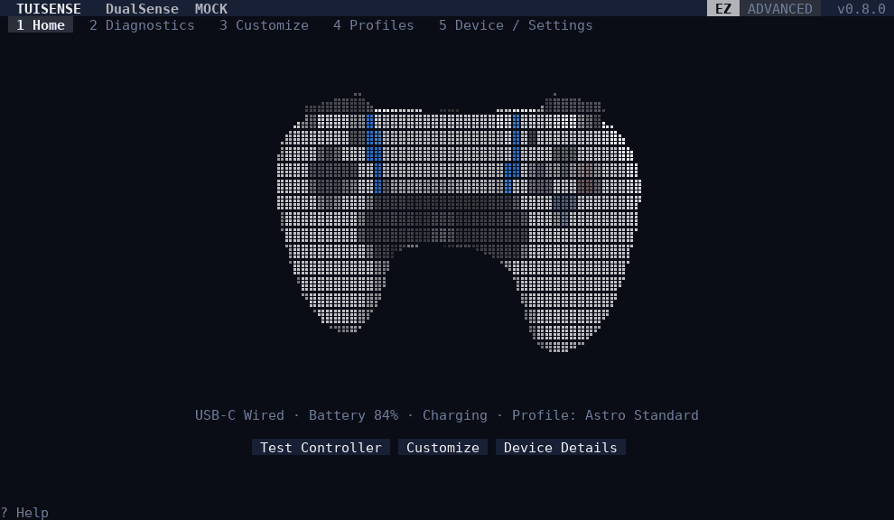
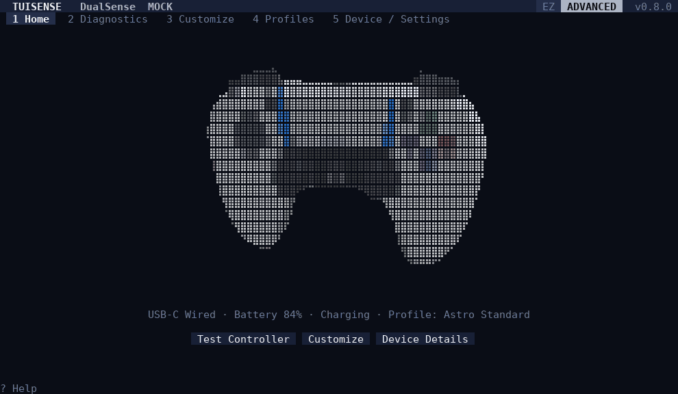
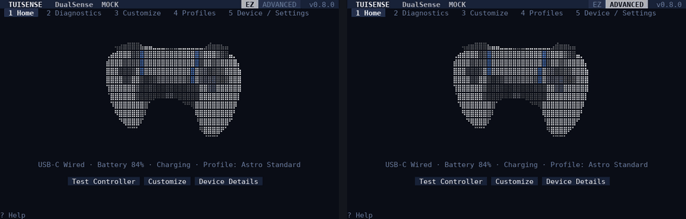
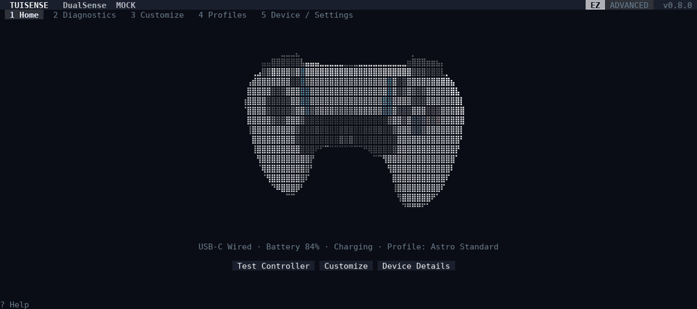
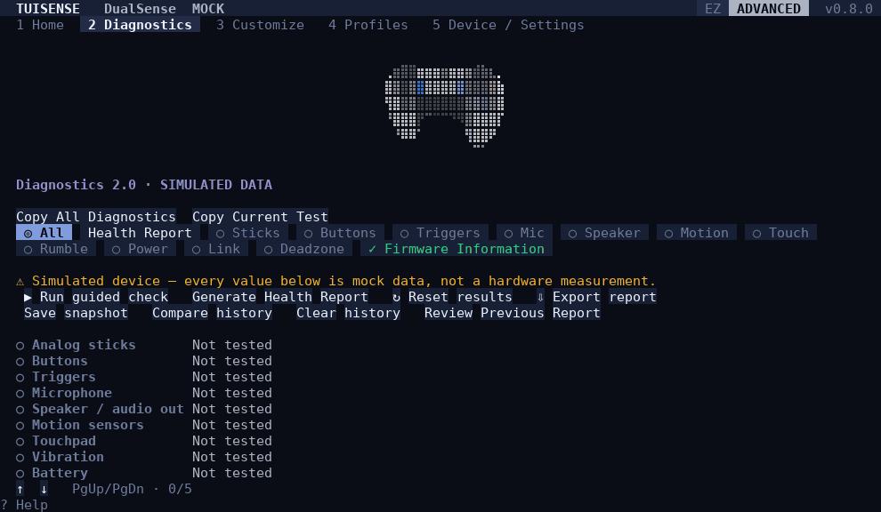
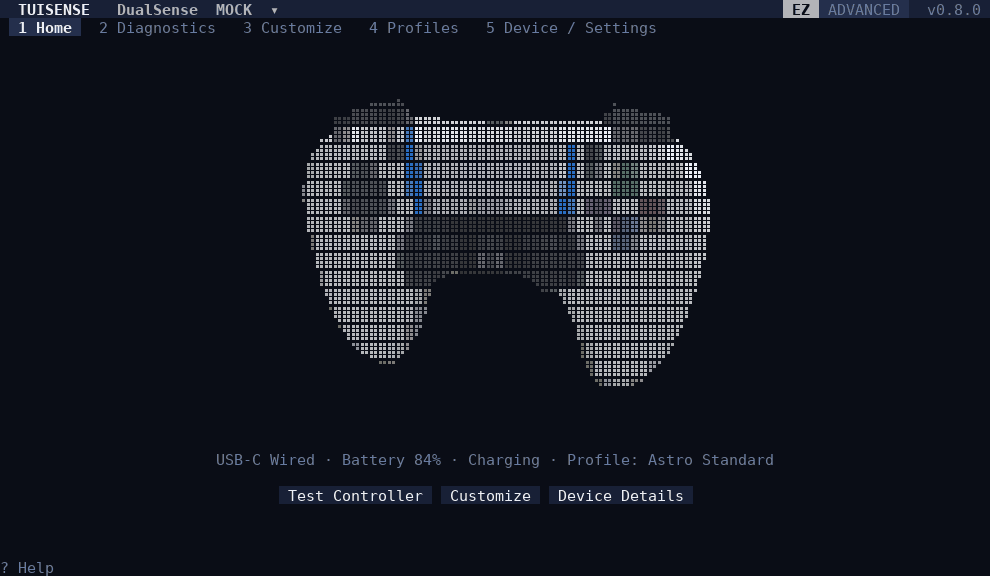
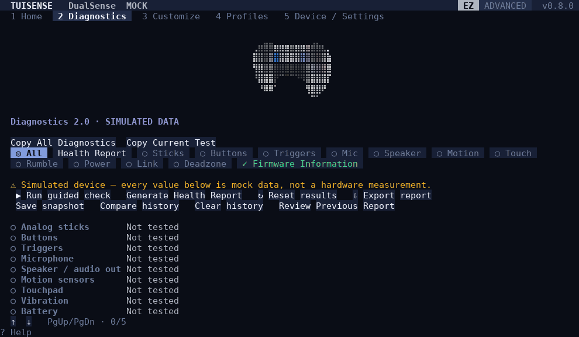
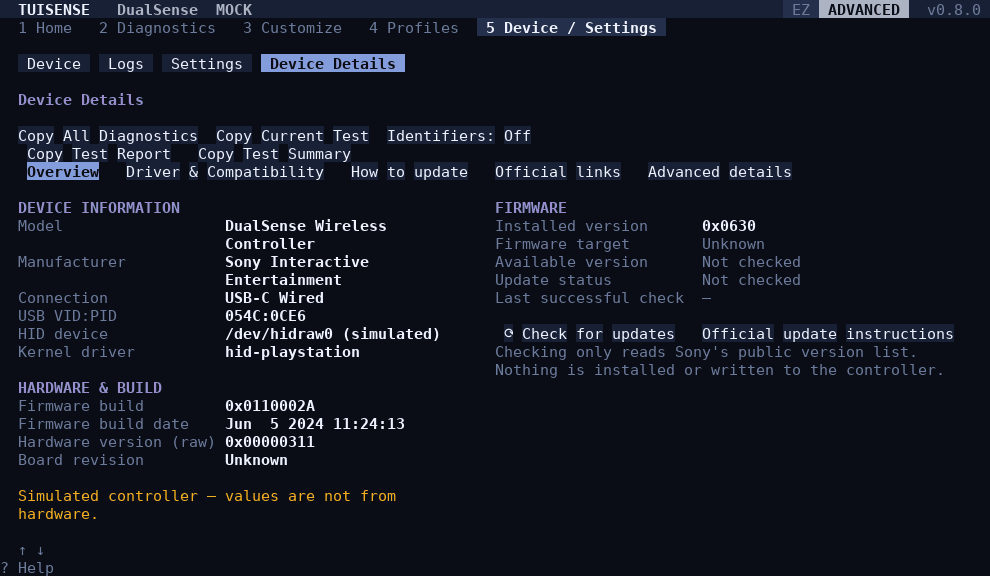

<div align="center">

# TuiSense

**Your Controller. Your Terminal.**

A terminal-native, extensible controller management platform for configuring,
testing, and understanding your game controllers.

[](https://github.com/Phobby/TuiSense/actions/workflows/ci.yml)
[](https://github.com/Phobby/TuiSense/releases)
[](LICENSE)
[](go.mod)

[](#platform-compatibility)
[](#platform-compatibility)
[](#platform-compatibility)



</div>

---

<!-- TUISENSE_PROMO_VIDEO_START -->
## See TuiSense in Action

*Official TuiSense showcase video coming soon.*

<!-- Replace this placeholder with the final promotional video link or thumbnail. -->
<!-- TUISENSE_PROMO_VIDEO_END -->

---

## Contents

- [Overview](#overview)
- [Quick Install](#quick-install)
- [Quick Start](#quick-start)
- [Features](#features)
- [Supported Controllers](#supported-controllers)
- [Platform Compatibility](#platform-compatibility)
- [Diagnostics](#diagnostics)
- [Firmware Safety](#firmware-safety)
- [Configuration and Profiles](#configuration-and-profiles)
- [Updating TuiSense](#updating-tuisense)
- [Keyboard and Mouse Controls](#keyboard-and-mouse-controls)
- [Building From Source](#building-from-source)
- [Troubleshooting](#troubleshooting)
- [FAQ](#faq)
- [Contributing](#contributing) · [Security](#security) · [License](#license) · [Acknowledgments](#acknowledgments)

## Overview

TuiSense puts an interactive 3D model of your controller in the middle of your
terminal. Everything around it — status, settings, diagnostics, even which tabs
exist — adapts to what **that specific controller** can actually do.

- **For players:** check whether a stick drifts, set the light bar color, pick a
  trigger feel, and get a plain-language health report you can copy and share.
- **For tinkerers:** raw measurements, per-motor haptics, force curves, device
  details and exportable JSON/Markdown reports in Advanced Mode.
- **For developers:** a capability-based driver model where adding a controller
  means describing what it has — the UI follows. See
  [Adding a New Controller](docs/ADDING_A_CONTROLLER.md).

TuiSense is honest about what it knows. Hardware a controller doesn't have never
appears; features TuiSense can't drive are labelled; simulated devices are
marked **MOCK**; and it never guesses a firmware version.

## Quick Install

> [!IMPORTANT]
> **The first signed release has not been published yet.** The installers below
> are tested end to end against a local release server; they will work as soon as
> the first release appears on the [Releases page](https://github.com/Phobby/TuiSense/releases).
> Until then, please [build from source](#building-from-source).

Installers detect your OS and CPU, download the official release from GitHub,
verify its **signature and checksum**, and install for your user only — no
`sudo`, no administrator rights, no Go toolchain.

**Linux and macOS** (installs to `~/.local/bin`)

```sh
curl -fsSL https://raw.githubusercontent.com/Phobby/TuiSense/main/scripts/install.sh | sh
```

Prefer to read it first?

```sh
curl -fsSLo install-tuisense.sh https://raw.githubusercontent.com/Phobby/TuiSense/main/scripts/install.sh
less install-tuisense.sh
sh install-tuisense.sh
```

**Windows** — PowerShell 5.1 or 7 (installs to `%LOCALAPPDATA%\Programs\TuiSense\bin`)

```powershell
irm https://raw.githubusercontent.com/Phobby/TuiSense/main/scripts/install.ps1 | iex
```

Or download, inspect, then run:

```powershell
irm https://raw.githubusercontent.com/Phobby/TuiSense/main/scripts/install.ps1 -OutFile install-tuisense.ps1
notepad install-tuisense.ps1
powershell -ExecutionPolicy Bypass -File install-tuisense.ps1
```

Then open a new terminal and run:

```sh
tuisense            # start
tuisense --version  # show the installed version
tuisense doctor     # check permissions, drivers, clipboard and terminal
```

<details>
<summary><b>Installer options, uninstalling, and manual download</b></summary>

| | Linux / macOS (`install.sh`) | Windows (`install.ps1`) |
| --- | --- | --- |
| Specific version | `--version 0.8.0` | `-Version 0.8.0` |
| Don't touch PATH | `--no-modify-path` | `-NoModifyPath` |
| Uninstall (keep settings) | `--uninstall` | `-Uninstall` |
| Uninstall everything | `--uninstall --purge` | `-Uninstall -Purge` |

Pass options to the piped Linux/macOS installer with `sh -s --`, e.g.
`curl -fsSL …/install.sh | sh -s -- --uninstall`.

**Manual download.** From the [Releases page](https://github.com/Phobby/TuiSense/releases)
download your archive (`tuisense_<version>_<os>_<arch>.tar.gz` or `.zip`),
`SHA256SUMS` and `SHA256SUMS.sig`, then verify:

```sh
# Use the ssh-ed25519 key line from internal/update/trusted_keys.txt:
echo "tuisense-release ssh-ed25519 AAAA…" > allowed_signers
ssh-keygen -Y verify -f allowed_signers -I tuisense-release -n tuisense-release -s SHA256SUMS.sig < SHA256SUMS
sha256sum --ignore-missing -c SHA256SUMS      # macOS: shasum -a 256 --ignore-missing -c SHA256SUMS
```

**macOS note.** Release binaries are not yet signed with an Apple Developer ID or
notarized. The installer downloads with `curl`, which does not quarantine files,
so `tuisense` starts normally. If you download the archive with a browser,
macOS blocks the first launch; allow that one file in
**System Settings → Privacy & Security → Open Anyway**. Never disable Gatekeeper.

</details>

## Quick Start

```sh
tuisense                 # real controllers only; waits for one to be plugged in
tuisense --mock          # try everything with a simulated DualSense (labelled MOCK)
tuisense doctor          # explain missing permissions or drivers
tuisense --help          # all commands and the settings/data directories
```

1. Connect a controller over USB or Bluetooth. It appears automatically.
2. Drag the 3D model to rotate it; click a button or stick to open its settings or test.
3. Press `2` for **Diagnostics**, run the guided check, then open the **Health Report**.
4. Press `E` to switch between **EZ** and **Advanced** mode at any time.

On Linux, DualSense lighting, triggers and haptics need write access to its
`hidraw` node. `tuisense doctor` tells you if that is missing, and
`tuisense --print-udev` prints the rule that grants it (see [Troubleshooting](#troubleshooting)).

## Features

> All demonstrations below are recorded from the real TuiSense interface
> (`go run ./tools/capture`), driven by its built-in **simulated** DualSense or
> test devices — note the **MOCK** label. They show the software, not a
> hardware measurement. How they are made: [docs/media/README.md](docs/media/README.md).

### Interactive 3D controller viewer

The controller is a real triangle mesh rendered in the terminal. Drag to orbit,
scroll to zoom, press `V` for the rear view and `R` to reset. Hover a part to see
its name; click it to open its settings or diagnostic. The **Controller Gallery**
(`G`) lets you browse all ten models — including rear paddles and back buttons —
without owning them; gallery models are labelled **VISUAL PREVIEW** and never
appear as connected devices.

<p align="center"></p>

### EZ Mode and Advanced Mode

**EZ Mode** (left) keeps things calm: a simple overview, a few plain-language
settings and a guided diagnostic. **Advanced Mode** (right) adds detailed
measurements, every capability panel, device information and update channels.
Same controller, same moment:

<p align="center"></p>

### Controller customization

Light bar color, vibration strength and adaptive-trigger feel are applied to the
controller and re-applied when it reconnects. Advanced Mode adds the full trigger
force-curve editor, per-motor haptics, an RGB picker, stick deadzones, motion and
audio. Only settings the connected model really supports are shown. The stick
**deadzone preview** is explicitly a preview: it does not change what games receive.

<p align="center"></p>

### Diagnostics 2.0

Guided tests for sticks (drift and snapback), triggers, buttons, touchpad, motion
sensors, vibration, microphone, speaker, battery and connection. Results are
plain language — *Normal*, *Possible drift*, *Further testing recommended*,
*Inconclusive* — never "broken". Advanced Mode shows raw values, statistics,
circularity and time-series graphs.

<p align="center"></p>

### Multi-controller architecture

Controllers are discovered and hot-plugged automatically, matched to a model, and
given exactly the panels their capabilities allow. Switch with `C`, `,` / `.`, or
the header. Here the simulated DualSense and two **test** devices (started with
`--test-devices`) show how different hardware gets different settings; real
devices are never mixed up with simulated ones.

<p align="center"></p>

### Controller health report

After a diagnostic run, TuiSense writes a concise health report: what was tested,
what looks normal, what deserves a second look and what to do next — with no
invented "health percentage". Copy the summary, a single test, the warnings, or a
technical report; export as TXT, Markdown or JSON. The report body is written in
Turkish regardless of the UI language.

<p align="center"></p>

### Firmware information

TuiSense reads what the controller reports about its firmware and compares it,
read-only, with the vendor's published update metadata. When it cannot tell
which firmware line a controller uses, it says *Unable to verify* instead of
guessing, and it explains the vendor's official update methods.

<p align="center"></p>

## Supported Controllers

Ten models have drivers and 3D models. Support depends on the operating system;
**no model is claimed as verified on real hardware yet** — features are covered
by automated tests against recorded and simulated device data.

| Controller | Linux | Windows | macOS |
| --- | --- | --- | --- |
| Sony DualSense | ✅ input, battery, lighting, adaptive triggers, haptics, audio, profiles, firmware check | — | — |
| Sony DualSense Edge | ✅ input, battery, lighting, adaptive triggers, haptics, back buttons, profiles, firmware check | — | — |
| Xbox Wireless Controller | ✅ input, battery, rumble | 🧪 XInput (generic) | — |
| Xbox Elite Series 2 | ✅ input, battery, rumble, paddles¹ | 🧪 XInput (generic) | — |
| Sony DualShock 4 | ✅ input, battery, rumble | — | — |
| Nintendo Switch Pro | ✅ input, battery, rumble | — | — |
| 8BitDo Ultimate Bluetooth | ✅ input, battery, rumble | 🧪 XInput (generic) | — |
| GameSir G7 SE | ✅ input, rumble | 🧪 XInput (generic) | — |
| Razer Wolverine V3 Pro | ✅ input, battery, rumble | 🧪 XInput (generic) | — |
| MSI Force GC20 V2 | ✅ input, rumble | 🧪 XInput (generic) | — |

✅ implemented · 🧪 experimental, unit-tested but not yet run on Windows hardware · — not available
¹ when the Linux kernel driver reports them.

On Linux, everything except the DualSense family goes through the kernel's own
drivers (`xpad`, `hid-playstation`, `hid-sony`, `hid-nintendo`, `hid-microsoft`);
TuiSense sends no vendor-specific commands to them. Detection IDs, connection
types and the exact status of every capability are in the generated
**[support matrix](docs/SUPPORT_MATRIX.md)**; driver details are in
[docs/DRIVERS.md](docs/DRIVERS.md).

### Controller-specific features

| Controller | What's special |
| --- | --- |
| DualSense / Edge | Native USB and Bluetooth output reports: adaptive-trigger effects with force curves, dual haptic motors, RGB light bar, player LEDs, mic and speaker tests, firmware info read from the controller |
| Xbox Elite Series 2 | Rear paddles P1–P4 in the 3D model and input tests (Linux, when exposed by the driver) |
| MSI Force GC20 V2 | Model identification from USB strings, input-mode-aware mapping |
| All models | Model-accurate 3D view and labels, guided diagnostics, health reports |

## Platform Compatibility

| | Linux | Windows | macOS |
| --- | --- | --- | --- |
| Terminal UI, 3D viewer, gallery, profiles, reports | ✅ | ✅ | ✅ |
| Controller backend | hidraw (DualSense) + evdev (all others) | XInput (Xbox-layout controllers) — experimental | not implemented yet |
| Controller audio | ALSA | — | — |
| Clipboard | `wl-copy`, `xclip`, `xsel`, OSC 52 | PowerShell `Set-Clipboard` | `pbcopy` |
| Release builds | amd64, arm64 | amd64, arm64 | Intel, Apple Silicon |

- **Linux** is the primary platform. It runs in any UTF-8 terminal under Wayland
  or X11, and no kernel modules are installed or changed.
- **Windows:** XInput cannot tell which model is connected, so controllers appear
  as a generic Xbox-layout controller with input, rumble and battery. DualSense,
  DualShock 4 and Switch Pro have no Windows backend yet. Use Windows Terminal for
  the best rendering.
- **macOS:** the app runs, but no controller backend is implemented yet, so it
  cannot see connected controllers.

## Diagnostics

Diagnostics measure every input report the controller sends (≈250 Hz on a wired
DualSense) using the device's own axis ranges, and nothing is uploaded anywhere.

- **Sticks:** a 4-step guided drift test, a snapback test, circularity, and an
  interactive deadzone preview.
- **Triggers:** rest → full press → smooth movement → return; adapts to analog,
  digital or shared-axis triggers.
- **Everything else:** buttons, touchpad, motion sensors, vibration, the
  controller's own microphone and speaker (never your PC's), battery and connection.
- **Reports:** copy any value with a click; copy or export the whole report; save
  snapshots and compare them over time. Unique identifiers are excluded unless you
  opt in.

Methods and thresholds: [docs/DIAGNOSTICS_2.md](docs/DIAGNOSTICS_2.md) ·
reports: [docs/HEALTH_REPORTS.md](docs/HEALTH_REPORTS.md).

## Firmware Safety

**TuiSense never downloads, installs or flashes controller firmware.** Its
firmware feature is read-only: it shows what the controller reports and compares
it with published metadata. To update firmware, use the vendor's official tool
(for DualSense: *PlayStation Accessories* on Windows, or a PS5); TuiSense shows
those instructions and links.

Updating **TuiSense itself** is a separate, unrelated system (see
[Updating TuiSense](#updating-tuisense)) and can never touch a controller.

## Configuration and Profiles

- Each controller remembers its own settings; they are re-applied when it reconnects.
- **Profiles** (`4` or `P`) save and load complete configurations as JSON files.
- Your mode (EZ/Advanced), language (English/Türkçe), last device and update
  preferences are stored in `settings.json`.
- `tuisense --help` prints the settings/profile and data directories for your
  system; `--config-dir` and `--profile-dir` override them.

Installing, updating and uninstalling TuiSense never removes these files
(unless you explicitly uninstall with `--purge` / `-Purge`).

## Updating TuiSense

```sh
tuisense update --check     # is a newer version available?
tuisense update             # download, verify and install it now
tuisense update --rollback  # go back to the version replaced by the last update
```

Inside the app, **Settings → Application updates** shows the installed and latest
version, the channel, the last check, download progress and release notes.

- **Automatic checks** are on by default (in the background when TuiSense
  starts, at most once an hour, 10-second timeout; offline use is silent). The
  result is shown next to the version in the top-right corner. You can turn
  checks off.
- **Automatic downloads** are off until you enable them. A downloaded update is
  verified and staged, never run; TuiSense then says it will be applied on restart.
- **Verification:** the release's checksum list must carry a valid Ed25519
  signature from a key pinned inside TuiSense, and the archive must match it, the
  right OS/CPU and the expected version. Otherwise the download is discarded.
- **Applying:** after you quit, the new binary is checked (`--version`) before it
  replaces the old one; the previous version is kept for `update --rollback`.
- **Package managers:** if TuiSense was installed by a package manager, it only
  tells you an update exists and never overwrites the package's files.
- **Prereleases** are offered only if you choose that channel.

## Keyboard and Mouse Controls

| Key | Action |
| :--- | :--- |
| `1`–`5` | Home · Diagnostics · Customize · Profiles · Device / Settings |
| `E` | Switch EZ ↔ Advanced mode |
| `C` · `,` / `.` | Choose controller · previous / next controller |
| `G` | Controller Gallery (`←` / `→` model, `Esc` back) |
| `F` | Device Details and firmware information |
| `P` | Profiles |
| `V` · `R` | Front / rear view · reset view |
| `W` `A` `S` `D` · `+` / `-` | Orbit · zoom |
| `Space` · `M` | Auto-orbit · shading mode |
| `[` / `]` | Previous / next controller part |
| `T` | Test vibration |
| `Tab` / `Shift+Tab`, arrows, `Enter` | Move between and change controls |
| `PgUp` / `PgDn` | Scroll long panels |
| `?` | Help |
| `Esc` | Close the open window or selection; otherwise asks before quitting |
| `Q` | Quit immediately |

**Mouse:** drag the model to rotate, scroll to zoom, double-click to reset,
click a part to open its settings or test, click any value to copy it, click the
header to switch controller or mode.

## Building From Source

Requirements: [Go 1.25+](https://go.dev/dl/). No C compiler or system libraries
are needed (`CGO_ENABLED=0` works everywhere).

```sh
git clone https://github.com/Phobby/TuiSense.git
cd TuiSense
make build          # → bin/tuisense
make install        # copy to ~/.local/bin (Linux/macOS)
make test           # run the test suite
./bin/tuisense --mock
```

Without `make`: `go build -o tuisense ./cmd/tuisense` (add `.exe` on Windows).
The version comes from the `VERSION` file via the Makefile's `-ldflags`; a plain
`go build` reports `dev`.

Project layout and design: [docs/ARCHITECTURE.md](docs/ARCHITECTURE.md) ·
3D models: [docs/3D_MODELS.md](docs/3D_MODELS.md) ·
releases: [docs/RELEASING.md](docs/RELEASING.md).

## Troubleshooting

Start with **`tuisense doctor`** — it checks your terminal, clipboard, audio,
controller permissions and kernel drivers and prints what to do. It never changes
your system by itself.

| Problem | Fix |
| --- | --- |
| DualSense visible but lighting/triggers do nothing (Linux) | Install the udev rule: `tuisense --print-udev \| sudo tee /etc/udev/rules.d/70-tuisense-dualsense.rules`, then `sudo udevadm control --reload-rules && sudo udevadm trigger`, and reconnect the controller. |
| No controller found | Check the cable carries data, try another port, run `tuisense debug devices`. Bluetooth controllers must be paired in your system first. |
| Copy does nothing | Install `wl-clipboard` (Wayland) or `xclip` (X11). Over SSH, start with `TUISENSE_OSC52=1` in a terminal that allows OSC 52. Otherwise TuiSense saves the text to a private file and shows its path. Details: [docs/CLIPBOARD.md](docs/CLIPBOARD.md). |
| Boxes instead of symbols, or a broken 3D model | Use a UTF-8 terminal with a font that includes Braille characters (most do); on Windows use Windows Terminal. |
| `tuisense: command not found` after installing | Open a new terminal; the installer added the folder to your PATH. |
| An update was downloaded but something is wrong | `tuisense update --rollback` restores the previous version. |

## FAQ

**Does TuiSense change how my controller behaves in games?**
Lighting, trigger effects and vibration settings are sent to the controller and
stay until something else changes them. Remapping and deadzone changes are not
applied to games — the deadzone tool is a preview.

**Can it update my controller's firmware?** No, never. See [Firmware Safety](#firmware-safety).

**Is the 3D model my exact controller?** It is a model of that controller type,
with approximate geometry. Gallery models are previews, not devices.

**Does it need root or administrator rights?** No. On Linux a one-time udev rule
(installed with `sudo` by you) grants access to DualSense output features.

**Does it send data anywhere?** Only two read-only requests, both optional: the
update check (GitHub Releases) and the firmware metadata check. Diagnostics and
reports stay on your computer.

**Why does the health report use Turkish?** The detailed report format is
currently Turkish-only; the rest of the interface is available in English and Turkish.

## Contributing

Contributions are welcome — bug reports, controller data, translations and code.

1. Open an issue describing the change or the controller you want to add.
2. Fork, create a branch, and keep changes focused.
3. Run `go vet ./...` and `go test ./...` (CI runs both on Linux, macOS and Windows).
4. If you change a driver descriptor, regenerate the matrix:
   `go run ./cmd/tuisense debug support-matrix > docs/SUPPORT_MATRIX.md`.

Reports from real hardware are especially valuable: the output of
`tuisense debug devices` and `tuisense debug inputs --watch 15` (no serial
numbers included) helps verify a model.

### Adding a new controller

Describe the controller's identity, physical parts and capabilities in a
descriptor, register it, and the UI adapts automatically. Step-by-step guide:
**[docs/ADDING_A_CONTROLLER.md](docs/ADDING_A_CONTROLLER.md)**.

## Security

Please report vulnerabilities privately through GitHub's
[security advisories](https://github.com/Phobby/TuiSense/security/advisories/new)
rather than a public issue.

The updater and installers only run binaries whose checksum list is signed by a
pinned TuiSense key; they use TLS verification as provided by the operating
system, never request elevated privileges, and never touch controller firmware or
kernel drivers. Details: [docs/RELEASING.md](docs/RELEASING.md).

## License

TuiSense is released under the [MIT License](LICENSE).

## Acknowledgments

- [Limoni](https://github.com/thebanri/limoni) — the Go TUI and terminal 3D engine TuiSense is built on.
- The Linux kernel input drivers (`hid-playstation`, `hid-sony`, `xpad`,
  `hid-nintendo`, `hid-microsoft`) and their maintainers.
- The SDL project's community-confirmed controller mappings, used as a reference
  for rear-paddle positions.
- Everyone who documented controller HID protocols in the open.
