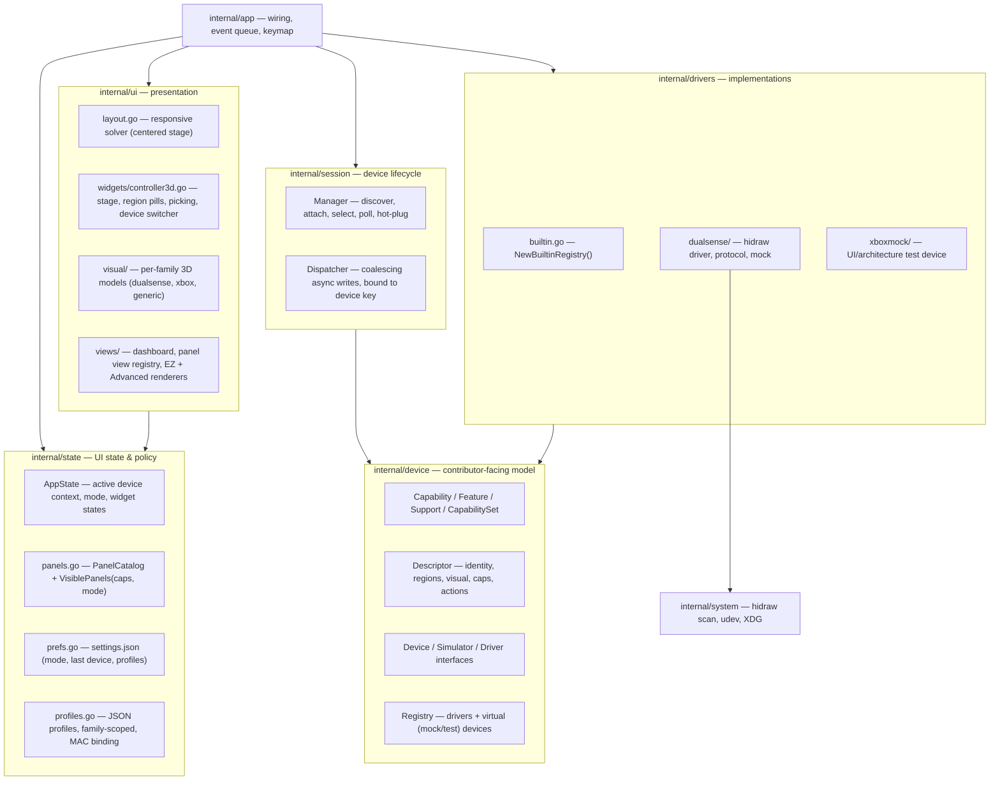
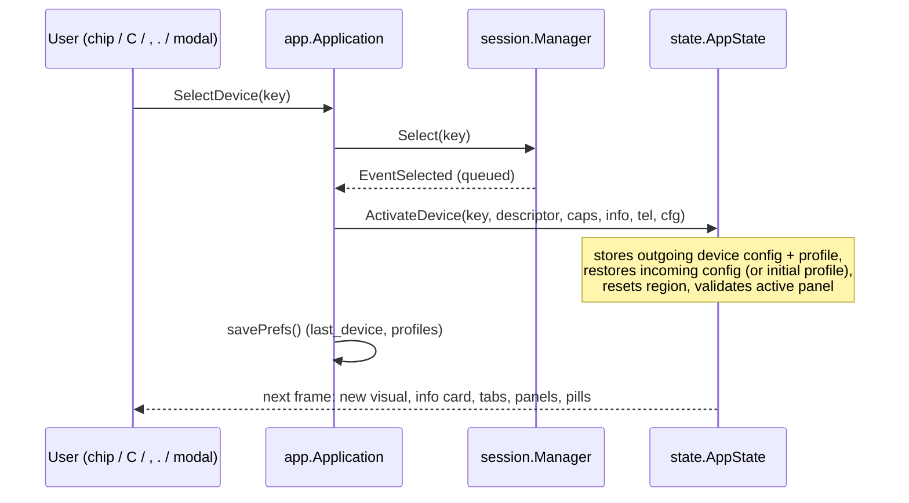

# TuiSense Architecture

TuiSense is a terminal-native, **capability-driven controller management platform**
built on the [Limoni](https://github.com/thebanri/limoni) TUI & 3D engine. The
Sony DualSense is the first real backend; the architecture is designed so further
controllers (Xbox, Switch Pro, 8BitDo, …) are added by writing a driver and a
descriptor — never by editing the UI core.

> Design rule: **the UI never asks "is this a DualSense?"**. It asks "does the
> active device support capability X / feature Y, and is the user in EZ or
> Advanced mode?".

---

## 1. Layers



Dependency direction is strictly downward: `device` imports nothing from
TuiSense except `logging`; drivers import `device`; `session` only knows the
`device.Registry`; the UI only reads `state`.

---

## 2. Folder structure

```text
internal/
├── device/                 # Universal controller model (stable contributor API)
│   ├── capability.go       # Capability, Feature, Support, CapabilitySet
│   ├── descriptor.go       # Descriptor, Region, PillSlot, Source, Action
│   ├── device.go           # Device, Simulator, Info, Availability()
│   ├── registry.go         # Driver, Candidate, VirtualDevice, Registry
│   ├── config.go           # Config (capability-grouped superset), sub-configs
│   ├── telemetry.go        # Telemetry
│   ├── commands.go         # Command union for async writes
│   └── triggers.go         # Trigger presets, force curves, stick curves
├── drivers/
│   ├── builtin.go          # NewBuiltinRegistry — one line per controller family
│   ├── dualsense/          # Real backend: descriptor, driver, protocol, hidraw, mock
│   └── xboxmock/           # Test-only Xbox device (no hardware)
├── session/
│   ├── manager.go          # Multi-device attach/select/poll/hot-plug
│   └── dispatcher.go       # 60 Hz coalescing writer bound to device keys
├── state/
│   ├── state.go            # AppState, ActivateDevice, SelectRegion, SetMode
│   ├── panels.go           # UXMode, PanelCatalog, VisiblePanels
│   ├── prefs.go            # Preferences persistence (settings.json)
│   └── profiles.go         # Profile store (family-scoped, MAC-bound)
├── ui/
│   ├── layout.go           # Wide / Stacked / Compact layouts
│   ├── visual/             # Visual registry + meshBuilder + per-family meshes
│   ├── widgets/            # Stage, status card, device card, help bar
│   └── views/              # Dashboard, panel registry, Advanced + EZ panels
├── app/                    # Application wiring, event queue, keymap
├── system/                 # Linux hidraw/sysfs discovery, udev, XDG dirs
├── theme/                  # Palettes and calm card styles
└── logging/                # Ring-buffer logger (Limoni LogSource)
```

---

## 3. Capability model

```go
type Capability string        // battery, connection, firmware_info, haptics,
                              // adaptive_triggers, lighting, sticks, motion,
                              // audio, profiles, diagnostics, firmware_update,
                              // remapping, calibration
type Feature string           // fine-grained: lightbar_rgb, player_leds, mic_led,
                              // led_brightness, dual_motors, trigger_motors, speaker, ...
type Support int              // Unsupported | Limited | Full

type CapabilitySpec struct {
    ID       Capability
    Support  Support
    Features []Feature
    Note     string           // shown to the user when Limited/Unsupported
}
type CapabilitySet map[Capability]CapabilitySpec   // absent ⇒ Unsupported
```

* **Descriptor capabilities** are the static baseline for a model.
* **`Device.Capabilities()`** is the *runtime* set and may be narrower (the
  DualSense drops `FeatSpeaker` over Bluetooth via `WithoutFeature`).
* **`device.Availability(info, caps, c)`** merges declared support with live
  state (disconnected → unavailable, permission denied → limited) and returns a
  user-facing reason.

How the UI consumes it:

| Level        | Tabs / panels                 | Region pills       | Inside a panel                     |
|--------------|-------------------------------|--------------------|------------------------------------|
| Full         | shown                         | normal             | all controls for declared features |
| Limited      | shown with `◐`                | normal             | banner with the note; only declared features rendered |
| Unsupported  | hidden                        | dimmed; click shows the note as a hint | — |

Panels render sub-sections by **feature**, not by model: e.g. the lighting
panel shows the RGB picker only with `FeatLightbarRGB`, the brightness row only
with `FeatLEDBrightness`; the haptics panel shows impulse-trigger sliders only
with `FeatTriggerMotors`.

---

## 4. Device, driver, registry

```go
type Device interface {
    Descriptor() Descriptor
    Info() Info
    Capabilities() CapabilitySet
    Telemetry() Telemetry
    CurrentConfig() Config
    Poll(ctx) (Telemetry, error)
    ApplyConfig(ctx, Config) error
    ExecuteCommand(ctx, Command) error
    Close() error
}
type Simulator interface { ToggleConnection() bool; CycleTransport() ConnectionType; TogglePermissionError() bool }

type Driver interface {               // real hardware for one family
    ID() string
    Models() []Descriptor
    Discover() ([]Candidate, error)  // cheap, called every 1.5 s; (nil,nil) on unsupported OS
    Open(Candidate, *logging.Logger) (Device, error)
}
type VirtualDevice struct {           // mock or test device factory
    Key string; Source Source; Descriptor Descriptor
    AutoAttach bool                   // test devices: listed from startup
    New func(*logging.Logger) Device
}
```

`drivers.NewBuiltinRegistry` registers:

| Entry               | Kind            | Attached when                                      |
|---------------------|-----------------|----------------------------------------------------|
| `dualsense` driver  | hardware        | every discovered hidraw node (unless `--mock`)     |
| `mock:dualsense`    | `SourceMock`    | `--mock`, or no hardware and mock fallback allowed |
| `test:xbox`         | `SourceTest`    | always (unless `--no-test-devices`); never auto-selected |

### Selection policy (`session.Manager`)

1. Persisted `last_device` if attached → 2. first hardware → 3. first mock → 4. none.
2. Hot-plugged hardware takes over only from *nothing* or from a *fallback* mock;
   an explicit user choice (e.g. the Xbox test device) is never overridden.
3. Removed hardware is detached; if it was active the UI drops to the
   no-controller placeholder.
4. Only the active device is polled (25 Hz).
5. The dispatcher captures the active device key **when a command is issued**,
   so switching devices never redirects queued writes.

Session events are queued and applied on the render goroutine at the start of
each frame (`Application.drainEvents`), so `AppState` is only mutated by one goroutine.

---

## 5. UI layout

The controller is the focal point and is **horizontally centered** whenever the
terminal allows (enforced by `TestStageIsHorizontallyCentered`).

```text
Wide (≥150 cols)                                   Stacked (≥96 cols, ≥36 rows)
┌ TUISENSE ◆ DualSense ▾ ······· EZ │ ADVANCED ┐   ┌ header ─────────────────────────────┐
│ 1 Home 2 Lights 3 Vibration …                │   │ tabs                                │
├──────────┬────────────────────┬──────────────┤   ├────────┬──────────────────┬─────────┤
│ Device   │  DualSense  MOCK   │ Status       │   │ Status │   controller     │ Device  │
│ card     │   ◉L2   ◉Light  ◉R2│──────────────│   │────────│   (centered)     │ card    │
│──────────│     [ 3D model ]   │ Inspector    │   │ Live / │   ◉ pills        │         │
│ Live     │   ◉Hapt     ◉Mic   │ (contextual) │   │ Tips   │ ‹ ◆DS ◇Xbox ›    │         │
│ input /  │ ‹ ◆ DualSense ◇ Xbox›│            │   ├────────┴──────────────────┴─────────┤
│ tips     │                    │              │   │ Inspector (full width)              │
└──────────┴────────────────────┴──────────────┘   └─────────────────────────────────────┘
Compact (80×24): stage left, status + inspector right.
```

* **Header**: brand, device selector pill (opens the selector modal), device
  count, segmented **EZ / ADVANCED** switch.
* **Tabs**: generated from `VisiblePanels(caps, mode)`; number hotkeys follow
  the visible order; `◐` marks limited support.
* **Stage**: title + source tag (`MOCK` / `TEST`), Advanced-only camera toolbar,
  region pills placed by `Region.Slot` with collision avoidance, projected 3D
  picking from the visual's anchors, region description, device switcher chips.
* **Side cards**: status (connection, battery, profile), device card (EZ: 4
  rows; Advanced: identity, firmware, path, capability counts), live input
  (Advanced) or getting-started tips (EZ).

---

## 6. EZ mode vs Advanced mode

`state.PanelCatalog` is the single source of truth:

| Panel     | Capability gate      | EZ                         | Advanced |
|-----------|----------------------|----------------------------|----------|
| Overview  | —                    | **Home**: quick settings   | capability cards + actions |
| Lighting  | `lighting`           | on/off + color/brightness  | full picker, animations, player LEDs |
| Haptics   | `haptics`            | 4-step strength + test     | per-motor sliders, impulse triggers |
| Triggers  | `adaptive_triggers`  | 5 named "feels"            | modes, presets, sliders, force curve |
| Sticks    | `sticks`             | —                          | ✓ |
| Motion    | `motion`             | —                          | ✓ |
| Audio     | `audio`              | —                          | ✓ |
| Profiles  | `profiles`           | one-click list             | save/load/delete/bind |
| Device    | `firmware_info`      | —                          | identity + capability matrix |
| Firmware  | `firmware_update`    | —                          | ✓ (simulated for the test device) |
| Logs      | `diagnostics`        | —                          | ✓ |
| Settings  | —                    | mode, rotation, contrast   | + 3D options, simulator |

* EZ panels have **dedicated renderers** (`views/ez.go`) — enforced by
  `TestEZPanelsHaveDedicatedRenderers`. They share action helpers with Advanced,
  so both modes edit the same config.
* Selecting a region whose panel is hidden in EZ keeps the user on Home with a
  hint ("… available in Advanced mode — press [E]").
* Switching mode re-validates the active panel (falls back to Overview).
* The mode is persisted in `settings.json`; first launch defaults to **EZ**.

---

## 7. Device switching flow



Initial config for a never-seen device: MAC-bound profile → remembered profile
for its family → `Descriptor.DefaultProfile` → `Descriptor.DefaultConfig()`.

---

## 8. Persistence

| File | Content |
|------|---------|
| `$XDG_CONFIG_HOME/tuisense/settings.json` | `mode`, `last_device`, `active_profiles` (per family), `high_contrast`, `auto_rotate` |
| `$XDG_CONFIG_HOME/tuisense/profiles/*.json` | profiles (`family: ""` = universal) |
| `$XDG_CONFIG_HOME/tuisense/profiles/_bindings.json` | MAC → profile |

`--config-dir` and `--profile-dir` override both locations.

---

## 9. Platform adapters

Drivers own platform access. The DualSense driver uses Linux hidraw via
`internal/system`; on macOS/Windows its `Discover` returns no candidates, and
the mock + test devices keep the UI fully usable. A future adapter (IOHIDManager,
Windows HID/SetupAPI, or hidapi) only needs to produce `Candidate`s and an
`io.ReadWriter`-like transport for the existing protocol encoder.

---

## 10. Testing

| Area | Test |
|------|------|
| Capability math, availability, registry | `internal/device/device_test.go` |
| Panel visibility, EZ vs Advanced, region routing, config memory, prefs, profile families | `internal/state/state_test.go` |
| Selection policy, mock fallback, no-controller, hot-plug takeover/removal, dispatcher binding, polling | `internal/session/manager_test.go` |
| Descriptor ↔ visual ↔ panel consistency for every registered model | `internal/drivers/builtin_test.go` |
| Every catalog panel renderable; EZ has own renderers | `internal/ui/views/registry_test.go` |
| Drift math & classification, cancel, guided buttons, triggers + resistance restore, haptic bounds/cleanup, ALSA endpoint selection, plan, mic signal/silence, disconnect, reports, battery honesty, connection rate | `internal/diag/diag_test.go` |
| Button decoding, raw values, 2 touch points, queue drain / latching / gap counting (SOCK_SEQPACKET as fake hidraw) | `internal/drivers/dualsense/diag_protocol_test.go` |
| Diagnostics UI: device adaptation, region → test, simulated drift, cleanup on leaving, disconnect, export, EZ guided | `internal/app/diagnostics_test.go` |
| Every declared button lights up on its visual | `internal/ui/visual/visual_test.go` |
| Centered layout, compact fit | `internal/ui/layout_test.go` |
| End-to-end headless UI (device switching, selector modal, modes, persistence, no-controller fallback, 3D render) | `internal/app/app_test.go` |
| DualSense HID protocol | `internal/drivers/dualsense/protocol_test.go` |

Integration tests inject a registry without hardware drivers and temporary
config/profile directories, so they never touch real devices or user files.

---

## 11. Diagnostics & Device Health Center

```text
internal/diag/      pure diagnostics engine (no UI, no driver code)
  plan.go           Plan(DeviceContext) → per-category Available / Unsupported / Unavailable
  sticks.go         drift test: stationary → movement → recenter; raw-count statistics
  buttons.go        live state, press counts (latched between polls), guided press-each-button
  triggers.go       rest / full-travel sweep, digital activation point, bounded adaptive resistance
  touch_motion.go   touch coverage, contacts & click; gyro/accel stillness noise + axis response
  haptics.go        bounded patterns (≤0.35 s, ≤90%), user-confirmed results, Stop restores config
  battery_conn.go   reported battery + attributes + change log; report rate, sequence gaps, interruptions
  audio.go          mic monitor / 3 s in-memory record & playback; speaker chime
  session.go        per-device session, statuses, guided run, Suspend() cleanup
  report.go         JSON + text export (no MAC/path unless opted in, never audio)
internal/audio/     Backend interface; ALSA (Linux) + Simulated; endpoint matching
internal/drivers/simulate/  scenario-driven synthetic input for mock/test devices
```

**Driver contract.** A driver declares diagnostics through its descriptor —
`Descriptor.Inputs` (`device.InputLayout`): buttons with model labels, raw stick
and trigger ranges, drift heuristics with a written rationale, touchpad contacts
and size, nominal IMU scales, battery reporting step, and an `AudioMatch` (USB
IDs) — plus capabilities. Optional interfaces: `BatteryDetailsProvider`
(genuinely reported battery attributes only) and `ScenarioSimulator` (mocks).
Telemetry carries `Raw` values (no deadzone/scaling), `Buttons` /
`ButtonsLatched`, two `Touch` points, `ReportsDropped`, `ReadErrors`, `Simulated`.

**Availability** is decided only by `diag.Plan`: sticks need declared sticks +
`CapSticks`; touchpad needs `TouchpadContacts`; audio needs the audio feature,
a USB link when `RequiresUSB`, and a sound card whose USB ID matches — the
system's own devices can never be selected. Unsupported categories are hidden
from the test tabs and listed (with the reason) in the summary/report.

**Statuses.** Not tested · Testing · Passed · Warning · Failed · Unsupported ·
Unavailable · Inconclusive. `Passed` requires a measurement or an explicit user
confirmation (marked `user_confirmed`). Stick drift is `Failed` only when two
separate resting measurements both exceed the declared tolerance and the
configured deadzone; a single run can at most warn ("possible drift").

**Safety.** Tests that actuate hardware (vibration, trigger resistance, audio)
start only from an explicit action, are time-bounded, and are stopped by
`Session.Suspend()` when the user leaves the tab, switches device, the device
disconnects, or the app quits (the dispatcher is flushed on exit). Restores use
`Actuator.CurrentConfig()` — the user's untouched settings; diagnostics never
modify config, calibration, or deadzones. Mic capture runs only while the user
keeps the test running; recordings live in memory and are discarded on stop.

**Input pipeline fix.** The Linux backend now drains every queued hidraw report
per poll with raw non-blocking reads (`SyscallConn`), OR-ing buttons into
`ButtonsLatched` and counting sequence gaps. Previously `File.Read`/`File.Fd()`
made reads block until the next report, and only 4 of ~10 queued reports were
read per 40 ms poll, so state lagged and short presses could be missed.

| Category | DualSense (USB / BT) | Xbox test device |
|----------|----------------------|------------------|
| Sticks, buttons, triggers, touchpad, motion | real input reports | simulated |
| Adaptive resistance | real (feel-confirmed) | — (impulse triggers) |
| Vibration | real rumble (feel-confirmed) | commands recorded only |
| Microphone / speaker | USB audio class via ALSA; unavailable over BT | speaker/headset simulated; no mic |
| Battery | input report + sysfs `power_supply`; health "Not available" | simulated level |
| Connection | report rate, sequence gaps, read errors, interruptions | poll-rate based |

## 12. Roadmap

1. **Foundation (done)** — capability model, registry, multi-device session,
   centered layout, EZ/Advanced, mock Xbox test device, persistence, tests.
2. **Contributor ergonomics** — descriptor validation CLI (`tuisense --list-models`),
   golden-snapshot tests per visual.
3. **Second real backend** — Xbox (GIP over USB / BLE HID) behind the existing
   descriptor; promote `xboxmock` regions/capabilities to the real driver.
4. **Cross-platform adapters** — hidapi-based transport for macOS/Windows.
5. **Advanced capabilities** — remapping editor, stick calibration, firmware
   update flow (with explicit safety confirmations), DualSense Edge slots.
6. **Plugins** — out-of-process drivers speaking a small JSON-RPC protocol,
   registered as `Driver`s.
