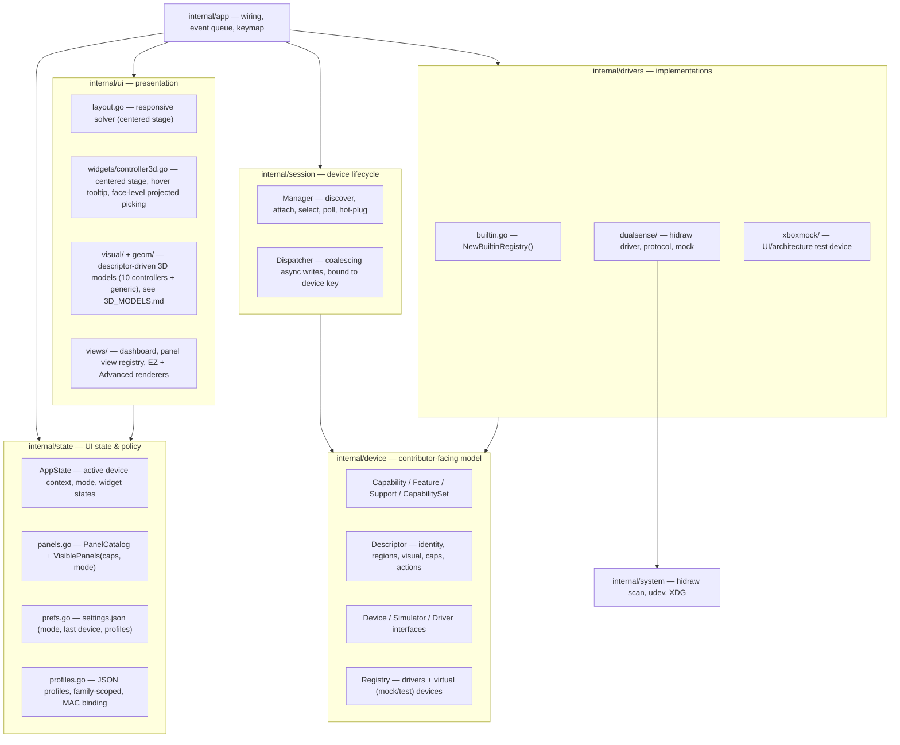
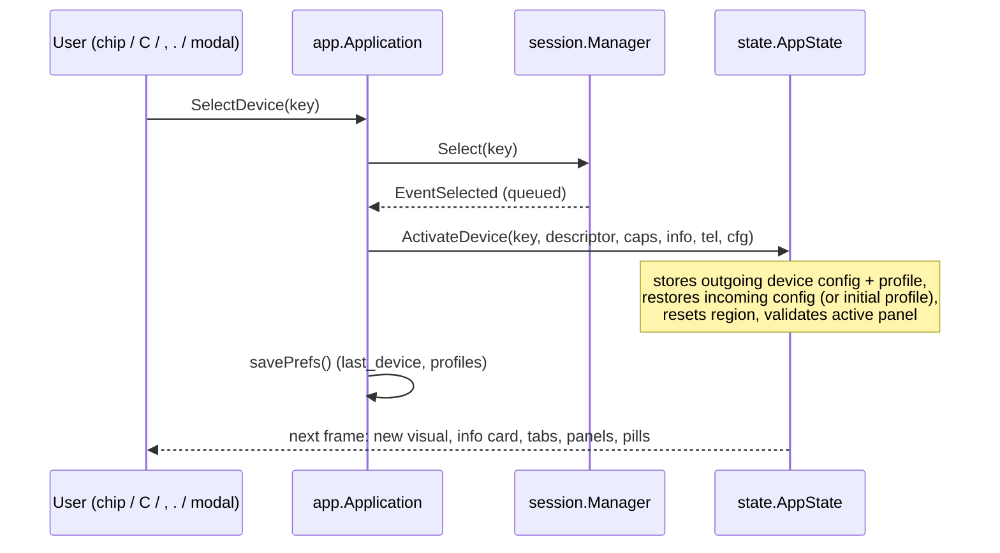

# TuiSense Architecture

TuiSense is a terminal-native, **capability-driven controller management platform**
built on the [Limoni](https://github.com/thebanri/limoni) TUI & 3D engine. The
Sony DualSense is the first real backend; the architecture is designed so further
controllers (Xbox, Switch Pro, 8BitDo, …) are added by writing a driver and a
descriptor — never by editing the UI core.

> Design rule: **the UI never asks "is this a DualSense?"**. It asks "does the
> active device support capability X / feature Y, and is the user in EZ or
> Advanced mode?".

---

## 1. Layers



Dependency direction is strictly downward: `device` imports nothing from
TuiSense except `logging`; drivers import `device`; `session` only knows the
`device.Registry`; the UI only reads `state`.

---

## 2. Folder structure

```text
internal/
├── device/                 # Universal controller model (stable contributor API)
│   ├── capability.go       # Capability, Feature, Support, CapabilitySet
│   ├── descriptor.go       # Descriptor, Region, Source, Action
│   ├── operations.go       # Operation table + Authorize (command gate)
│   ├── device.go           # Device, Simulator, Info, Availability()
│   ├── registry.go         # Driver, Candidate, VirtualDevice, Registry
│   ├── config.go           # Config (capability-grouped superset), sub-configs
│   ├── telemetry.go        # Telemetry
│   ├── commands.go         # Command union for async writes
│   └── triggers.go         # Trigger presets, force curves, stick curves
├── drivers/
│   ├── builtin.go          # NewBuiltinRegistry — one line per controller family
│   ├── dualsense/          # Real backend: descriptor, driver, protocol, hidraw, mock
│   └── xboxmock/           # Test-only Xbox device (no hardware)
├── session/
│   ├── manager.go          # Multi-device attach/select/poll/hot-plug
│   └── dispatcher.go       # 60 Hz coalescing writer bound to device keys
├── state/
│   ├── state.go            # AppState, ActivateDevice, SelectRegion, SetMode
│   ├── panels.go           # UXMode, PanelCatalog, VisiblePanels
│   ├── prefs.go            # Preferences persistence (settings.json)
│   └── profiles.go         # Profile store (family-scoped, MAC-bound)
├── ui/
│   ├── layout.go           # Wide / Stacked / Compact layouts
│   ├── geom/               # Mesh primitives, outlines, ear clipping
│   ├── visual/             # ModelSpec registry, generator, picking, 10 controller models
│   ├── widgets/            # Stage, status card, device card, help bar
│   └── views/              # Dashboard, panel registry, Advanced + EZ panels
├── app/                    # Application wiring, event queue, keymap
├── system/                 # Linux hidraw/sysfs discovery, udev, XDG dirs
├── theme/                  # Palettes and calm card styles
└── logging/                # Ring-buffer logger (Limoni LogSource)
```

---

## 3. Capability model

```go
type Capability string        // battery, connection, firmware_info, haptics,
                              // adaptive_triggers, lighting, sticks, motion,
                              // audio, profiles, diagnostics, firmware_update,
                              // firmware_check, remapping, calibration
type Feature string           // fine-grained: lightbar_rgb, player_leds, mic_led,
                              // led_brightness, dual_motors, trigger_motors, speaker, ...
type Support int              // Unsupported | Limited | Full

type CapabilitySpec struct {
    ID       Capability
    Support  Support
    Features []Feature
    Note     string           // shown to the user when Limited/Unsupported
}
type CapabilitySet map[Capability]CapabilitySpec   // absent ⇒ Unsupported
```

* **Descriptor capabilities** are the static baseline for a model.
* **`Device.Capabilities()`** is the *runtime* set and may be narrower (the
  DualSense drops `FeatSpeaker` over Bluetooth via `WithoutFeature`).
* **`device.Availability(info, caps, c)`** merges declared support with live
  state (disconnected → unavailable, permission denied → limited) and returns a
  user-facing reason.

How the UI consumes it:

| Level        | Tabs / panels                 | Region pills       | Inside a panel                     |
|--------------|-------------------------------|--------------------|------------------------------------|
| Full         | shown                         | normal             | all controls for declared features |
| Limited      | shown with `◐`                | normal             | banner with the note; only declared features rendered |
| Unsupported  | hidden                        | dimmed; click shows the note as a hint | — |

Panels render sub-sections by **feature**, not by model: e.g. the lighting
panel shows the RGB picker only with `FeatLightbarRGB`, the brightness row only
with `FeatLEDBrightness`; the haptics panel shows impulse-trigger sliders only
with `FeatTriggerMotors`.

---

## 4. Device, driver, registry

```go
type Device interface {
    Descriptor() Descriptor
    Info() Info
    Capabilities() CapabilitySet
    Telemetry() Telemetry
    CurrentConfig() Config
    Poll(ctx) (Telemetry, error)
    ApplyConfig(ctx, Config) error
    ExecuteCommand(ctx, Command) error
    Close() error
}
type Simulator interface { ToggleConnection() bool; CycleTransport() ConnectionType; TogglePermissionError() bool }

type Driver interface {               // real hardware for one family
    ID() string
    Models() []Descriptor
    Discover() ([]Candidate, error)  // cheap, called every 1.5 s; (nil,nil) on unsupported OS
    Open(Candidate, *logging.Logger) (Device, error)
}
type VirtualDevice struct {           // mock or test device factory
    Key string; Source Source; Descriptor Descriptor
    AutoAttach bool                   // test devices: listed from startup
    New func(*logging.Logger) Device
}
```

`drivers.NewBuiltinRegistry` registers:

| Entry               | Kind            | Attached when                                      |
|---------------------|-----------------|----------------------------------------------------|
| `dualsense` driver  | hardware        | every discovered hidraw node (unless `--mock`)     |
| `mock:dualsense`    | `SourceMock`    | explicit `--mock` (internal tests may opt into fallback) |
| `test:xbox`         | `SourceTest`    | explicit `--test-devices`; never auto-selected |

### Selection policy (`session.Manager`)

1. Persisted `last_device` if attached → 2. first hardware → 3. first mock → 4. none.
2. Hot-plugged hardware takes over only from *nothing* or from a *fallback* mock;
   an explicit user choice (e.g. the Xbox test device) is never overridden.
3. Removed hardware is detached; if it was active the UI drops to the
   no-controller placeholder.
4. Only the active device is polled (25 Hz).
5. The dispatcher captures the active device key **when a command is issued**,
   so switching devices never redirects queued writes.

Session events are queued and applied on the render goroutine at the start of
each frame (`Application.drainEvents`), so `AppState` is only mutated by one goroutine.

---

## 5. UI layout

The controller is the focal point and is **horizontally centered** whenever the
terminal allows (enforced by `TestStageIsHorizontallyCentered`).

```text
Wide (≥150 cols)                                   Stacked (≥96 cols, ≥36 rows)
┌ TUISENSE ◆ DualSense ▾ ······· EZ │ ADVANCED ┐   ┌ header ─────────────────────────────┐
│ 1 Home 2 Lights 3 Vibration …                │   │ tabs                                │
├──────────┬────────────────────┬──────────────┤   ├────────┬──────────────────┬─────────┤
│ Device   │  DualSense  MOCK   │ Status       │   │ Status │   controller     │ Device  │
│ card     │   ◉L2   ◉Light  ◉R2│──────────────│   │────────│   (centered)     │ card    │
│──────────│     [ 3D model ]   │ Inspector    │   │ Live / │   ◉ pills        │         │
│ Live     │   ◉Hapt     ◉Mic   │ (contextual) │   │ Tips   │ ‹ ◆DS ◇Xbox ›    │         │
│ input /  │ ‹ ◆ DualSense ◇ Xbox›│            │   ├────────┴──────────────────┴─────────┤
│ tips     │                    │              │   │ Inspector (full width)              │
└──────────┴────────────────────┴──────────────┘   └─────────────────────────────────────┘
Compact (80×24): stage left, status + inspector right.
```

* **Header**: brand, device selector pill (opens the selector modal), device
  count, segmented **EZ / ADVANCED** switch.
* **Tabs**: generated from `VisiblePanels(caps, mode)`; number hotkeys follow
  the visible order; `◐` marks limited support.
* **Stage**: the active model (or the gallery model) drawn by `Viewer3D`, a
  hover tooltip, face-level projected picking (`visual.Model.Pick`) and one
  contextual line for the selected component. See [3D_MODELS.md](3D_MODELS.md).
* **Side cards**: status (connection, battery, profile), device card (EZ: 4
  rows; Advanced: identity, firmware, path, capability counts), live input
  (Advanced) or getting-started tips (EZ).

---

## 6. EZ mode vs Advanced mode

`state.PanelCatalog` is the single source of truth:

| Panel     | Capability gate      | EZ                         | Advanced |
|-----------|----------------------|----------------------------|----------|
| Overview  | —                    | **Home**: quick settings   | capability cards + actions |
| Lighting  | `lighting`           | on/off + color/brightness  | full picker, animations, player LEDs |
| Haptics   | `haptics`            | 4-step strength + test     | per-motor sliders, impulse triggers |
| Triggers  | `adaptive_triggers`  | 5 named "feels"            | modes, presets, sliders, force curve |
| Sticks    | `sticks`             | —                          | ✓ |
| Motion    | `motion`             | —                          | ✓ |
| Audio     | `audio`              | —                          | ✓ |
| Profiles  | `profiles`           | one-click list             | save/load/delete/bind |
| Device    | `firmware_info`      | —                          | identity + capability matrix |
| Device Details | — (any controller) | device info, firmware version/target/status, check, how to update | + build, driver, per-target comparison, metadata source, every raw reading with its origin |
| Logs      | `diagnostics`        | —                          | ✓ |
| Settings  | —                    | mode, rotation, contrast   | + 3D options, simulator |

* EZ panels have **dedicated renderers** (`views/ez.go`) — enforced by
  `TestEZPanelsHaveDedicatedRenderers`. They share action helpers with Advanced,
  so both modes edit the same config.
* Selecting a region whose panel is hidden in EZ keeps the user on Home with a
  hint ("… available in Advanced mode — press [E]").
* Switching mode re-validates the active panel (falls back to Overview).
* The mode is persisted in `settings.json`; first launch defaults to **EZ**.

---

## 7. Device switching flow



Initial config for a never-seen device: MAC-bound profile → remembered profile
for its family → `Descriptor.DefaultProfile` → `Descriptor.DefaultConfig()`.

---

## 8. Persistence

| File | Content |
|------|---------|
| `$XDG_CONFIG_HOME/tuisense/settings.json` | `mode`, `last_device`, `active_profiles` (per family), `high_contrast`, `auto_rotate`, `firmware_auto_check` |
| `$XDG_CONFIG_HOME/tuisense/firmware.json` | last successful firmware check per controller (time, status, versions, last notified version) |
| `$XDG_CONFIG_HOME/tuisense/profiles/*.json` | profiles (`family: ""` = universal) |
| `$XDG_CONFIG_HOME/tuisense/profiles/_bindings.json` | MAC → profile |

`--config-dir` and `--profile-dir` override both locations.

---

## 9. Platform adapters

Drivers own platform access. The DualSense driver uses Linux hidraw via
`internal/system`; on macOS/Windows its `Discover` returns no candidates, and
the mock + test devices keep the UI fully usable. A future adapter (IOHIDManager,
Windows HID/SetupAPI, or hidapi) only needs to produce `Candidate`s and an
`io.ReadWriter`-like transport for the existing protocol encoder.

---

## 10. Testing

| Area | Test |
|------|------|
| Capability math, availability, registry | `internal/device/device_test.go` |
| Panel visibility, EZ vs Advanced, region routing, config memory, prefs, profile families | `internal/state/state_test.go` |
| Selection policy, mock fallback, no-controller, hot-plug takeover/removal, dispatcher binding, polling | `internal/session/manager_test.go` |
| Descriptor ↔ visual ↔ panel consistency for every registered model | `internal/drivers/builtin_test.go` |
| Every catalog panel renderable; EZ has own renderers | `internal/ui/views/registry_test.go` |
| Drift math & classification, cancel, guided buttons, triggers + resistance restore, haptic bounds/cleanup, ALSA endpoint selection, plan, mic signal/silence, disconnect, reports, battery honesty, connection rate | `internal/diag/diag_test.go` |
| Button decoding, raw values, 2 touch points, queue drain / latching / gap counting (SOCK_SEQPACKET as fake hidraw) | `internal/drivers/dualsense/diag_protocol_test.go` |
| Diagnostics UI: device adaptation, region → test, simulated drift, cleanup on leaving, disconnect, export, EZ guided | `internal/app/diagnostics_test.go` |
| Ten distinct models; budgets, surfaces, picking after rotation, no rear mirroring, framing, live-input binding | `internal/ui/visual/visual_test.go` |
| Turkish catalog coverage, valid format strings, fallback, locale detection | `internal/i18n/i18n_test.go` |
| Language switch from Settings (EZ + Advanced), live UI update, persistence | `internal/app/language_test.go` |
| Centered layout, compact fit | `internal/ui/layout_test.go` |
| End-to-end headless UI (device switching, selector modal, modes, persistence, no-controller fallback, 3D render) | `internal/app/app_test.go` |
| DualSense HID protocol | `internal/drivers/dualsense/protocol_test.go` |
| Firmware report 0x20 decoding, BT CRC, no invented values | `internal/drivers/dualsense/firmware_test.go` |
| Device details: real BT report fixture, firmware vs hardware separation, unknown target, USB hint, permission/sysfs fallback, sysfs mismatch | `internal/drivers/dualsense/details_test.go`, `internal/system/hidsysfs_test.go`, `internal/device/details_test.go` |
| Metadata parsing, malformed/changed responses, HTTPS-only fetch, timeout, offline, target comparison, unknown revisions, wrong mappings | `internal/firmware/sony/*_test.go` |
| Service: no/multiple controllers, unsupported devices (MSI, Xbox), persistence, one notification per version, timeout | `internal/firmware/service_test.go` |
| Device Details UI: non-blocking check, EZ/Advanced sections, status rendering, controller switching, stale results, official links only, notification, auto-check policy | `internal/app/firmware_test.go` |

Integration tests inject a registry without hardware drivers and temporary
config/profile directories, so they never touch real devices or user files.

---

## 11. Diagnostics & Device Health Center

```text
internal/diag/      pure diagnostics engine (no UI, no driver code)
  plan.go           Plan(DeviceContext) → per-category Available / Unsupported / Unavailable
  samples.go        per-report raw samples (no fabricated data), fresh-sample rate
  deadzone.go       radial deadzone preview (never applied to input)
  sticks.go         guided 4-step stick test, verdicts, travel/circularity
  snapback.go       sudden-release overshoot and settle-time measurement
  buttons.go        live state, press counts (latched between polls), guided press-each-button
  triggers.go       guided A–D trigger test (analog / digital / shared axis), bounded adaptive resistance
  touch_motion.go   touch coverage, contacts & click; gyro/accel stillness noise + axis response
  haptics.go        bounded patterns (≤0.35 s, ≤90%), user-confirmed results, Stop restores config
  battery_conn.go   reported battery + attributes + change log; report rate, sequence gaps, interruptions
  audio.go          mic monitor / 3 s in-memory record & playback; speaker chime
  session.go        per-device session, statuses, guided run, Suspend() cleanup
  report.go         JSON + text export (no MAC/path unless opted in, never audio)
internal/audio/     Backend interface; ALSA (Linux) + Simulated; endpoint matching
internal/drivers/simulate/  scenario-driven synthetic input for mock/test devices
```

**Driver contract.** A driver declares diagnostics through its descriptor —
`Descriptor.Inputs` (`device.InputLayout`): buttons with model labels, raw stick
and trigger ranges, drift heuristics with a written rationale, touchpad contacts
and size, nominal IMU scales, battery reporting step, and an `AudioMatch` (USB
IDs) — plus capabilities. Optional interfaces: `BatteryDetailsProvider`
(genuinely reported battery attributes only) and `ScenarioSimulator` (mocks).
Telemetry carries `Raw` values (no deadzone/scaling), `Buttons` /
`ButtonsLatched`, two `Touch` points, `ReportsDropped`, `ReadErrors`, `Simulated`.

**Availability** is decided only by `diag.Plan`: sticks need declared sticks +
`CapSticks`; touchpad needs `TouchpadContacts`; audio needs the audio feature,
a USB link when `RequiresUSB`, and a sound card whose USB ID matches — the
system's own devices can never be selected. Unsupported categories are hidden
from the test tabs and listed (with the reason) in the summary/report.

**Statuses.** Not tested · Testing · Passed · Warning · Failed · Unsupported ·
Unavailable · Inconclusive. `Passed` requires a measurement or an explicit user
confirmation (marked `user_confirmed`). Sticks and triggers additionally carry
a plain-language **verdict** (`diag.Verdict`): *Normal — within tolerance*,
*Possible drift* / *Possible issue*, *Further testing recommended*,
*Inconclusive*. Neither sticks nor triggers are ever `Failed`: a measurement
cannot prove a hardware defect, and every result explains what was measured,
what was expected, why it matters, how to repeat it, and whether an input mode
could explain it.

### Measurement pipeline (raw → normalized → measurement → conclusion → UI)

1. **Raw input.** Backends attach every report received since the last poll
   (`Telemetry.Samples`, ≈250 Hz on a wired DualSense; one sample per
   `SYN_REPORT` on evdev, plus one *held* sample per quiet poll because evdev
   only reports changes). An empty batch contributes nothing, so a controller
   that has not reported yet can never yield fabricated "centered" samples.
2. **Normalization.** `device.AxisRange.NormalizeBipolar/Unipolar` uses the
   driver-declared range and center — for evdev the kernel's absinfo, per axis
   (`InputLayout.StickAxes/TriggerAxes`). Each side of the center is scaled
   separately (0..255 with center 128 reaches exactly ±1), `Invert` flips an
   axis so all devices share one convention, and no deadzone is ever applied.
3. **Measurements** (`diag/sticks.go`, `diag/triggers.go`) run on sample
   timestamps, so a UI backlog is attributed to the step it was measured in.
4. **Conclusions** compare measurements with driver heuristics (stated as
   heuristics in the result and report).
5. **Presentation** (`ui/views/diagnostics_analog.go`) only renders.

### Guided stick test

Step 1 *Release the sticks* (0.5 s settle + 3 s sampling) → step 2 *What the
resting position means* (scope with center, live dot and deadzone ring, plus a
preliminary verdict) → step 3 *Full movement* (up, down, left, right — each
completes when both sticks reach 85% — then rotation until 14/16 rim sectors
are covered, then a second release) → step 4 *Result*. Verdicts: an offset
beyond tolerance in **both** resting measurements, at a consistent position, is
*Possible drift*; one off-center measurement or a changing center is *Further
testing recommended*; movement while "released" or too few samples is
*Inconclusive*. Advanced mode adds raw/normalized values, center offset
(% and counts), average/maximum resting deviation, noise σ, stability (mean
shift between halves), sample count and rate, travel coverage, circularity
(outer boundary per sector), and X/Y time series.

**Previous false positives (fixed).** The old test treated TuiSense's own
profile deadzone (which no game receives) as the threshold and declared
"Drift confirmed" (`Failed`) when two runs exceeded max(4 counts, that
deadzone) — about 3–6% on a DualSense, which many healthy sticks exceed. The
old trigger test ran a single timed "press fully, then release slowly" window
sampled at the 25 Hz UI poll rate: a press that did not land in the window was
reported as reaching "only X%" (Warning), and fast presses skipped positions
and produced "worn sensor" hints.

### Snapback test

`diag/snapback.go` is the second sub-test of the stick category (selector
*Deadzone test | Snapback test*; only one can run at a time, and both feed one
merged stick result via `mergeStickResults`). It detects
*sudden releases*: the stick at ≥90% of travel returns below 25% within
120 ms (hand-guided returns are counted and ignored). For 300 ms after each
release it measures the largest swing past the resting point opposite to the
push (overshoot), center crossings and the settle time (last moment outside a
3% band around the window's final position). Verdicts per stick: *Normal*
(every overshoot inside the deadzone preview), *Noticeable snapback* (Warning,
explained as common spring mechanics, never a defect), *Inconclusive* (fewer
than 3 releases, or a clean result measured below 100 samples/s, where short
overshoots can be missed). The deadzone preview is shared with the stick test.

### Deadzone preview

`diag.PreviewDeadzone` applies a scaled radial deadzone (0/3/5/8/10/15/20%) to
the live stick position: raw input → deadzone ring → effective game input.
It is labeled *Preview only — does not change game input* everywhere; TuiSense
has no input-processing backend, and the Sticks panel says the same about its
stored deadzone/curve values.

### Guided trigger test

A *Resting position* → B *Full press* (L, then R; large live bar; completes at
95%) → C *Smooth movement* (slow press and release; largest jump between
reports, positions covered) → D *Return to rest* (compared with A). The flow
adapts to `InputLayout.TriggerKind`: **digital** triggers get a press/release
test and no analog range checks; a **shared axis** learns which direction each
trigger moves it and explains that independent measurement is impossible. Not
reaching full travel is *Test incomplete* (Inconclusive), never a fault.

**Safety.** Tests that actuate hardware (vibration, trigger resistance, audio)
start only from an explicit action, are time-bounded, and are stopped by
`Session.Suspend()` when the user leaves the tab, switches device, the device
disconnects, or the app quits (the dispatcher is flushed on exit). Restores use
`Actuator.CurrentConfig()` — the user's untouched settings; diagnostics never
modify config, calibration, or deadzones. Mic capture runs only while the user
keeps the test running; recordings live in memory and are discarded on stop.

**Input pipeline fix.** The Linux backend now drains every queued hidraw report
per poll with raw non-blocking reads (`SyscallConn`), OR-ing buttons into
`ButtonsLatched` and counting sequence gaps. Previously `File.Read`/`File.Fd()`
made reads block until the next report, and only 4 of ~10 queued reports were
read per 40 ms poll, so state lagged and short presses could be missed.

| Category | DualSense (USB / BT) | MSI Force GC20 V2 (evdev) | Xbox test device |
|----------|----------------------|---------------------------|------------------|
| Sticks, buttons, triggers | real input reports | real evdev events; mapping inferred per input mode | simulated |
| Touchpad, motion | real input reports | — (not on the hardware) | touch/motion unsupported |
| Adaptive resistance | real (feel-confirmed) | — | — (impulse triggers) |
| Vibration | real rumble (feel-confirmed) | Linux FF_RUMBLE when the kernel driver exposes it; otherwise unsupported | commands recorded only |
| Microphone / speaker | USB audio class via ALSA; unavailable over BT | — | speaker/headset simulated; no mic |
| Battery | input report + sysfs `power_supply`; health "Not available" | — (wired, no battery) | simulated level |
| Connection | report rate, sequence gaps, read errors, interruptions | event rate (change-driven), read errors, USB details | poll-rate based |

## 11a. Generic evdev gamepads and the MSI Force GC20 V2

```text
internal/system/evdev/      sysfs scan (capability bitmaps, USB parent, kernel driver),
                            EVIOCGABS / EVIOCGKEY, non-blocking event reads, FF upload/play/erase
internal/drivers/gamepad/   generic driver: InferMapping (layout-agnostic), Backend, identity Resolve
internal/drivers/msigc20/   MSI model: Identify, Describe, ModeHint, documented mode table
internal/debugcmd/          `tuisense debug devices|inputs [--watch N]`
```

* **No hardcoded layout.** `gamepad.InferMapping` reads what Linux exposes:
  X/Y + RX/RY sticks with Z/RZ analog triggers (xpad / XInput), Z/RZ as the
  right stick (DirectInput), BRAKE/GAS triggers, a lone shared Z axis,
  BTN_TL2/TR2 digital triggers, hat or button d-pads, and generic joystick
  buttons (shown as *Button 1…N*, never guessed). Ranges come from absinfo.
* **Identification** (`msigc20.Identify`): MSI vendor ID 0db0 or USB strings
  naming MSI/GC20 → identified. 045e:028e version 0210 — the SDL community
  database entry for the GC20 V2 in its default (XInput) mode, shared with
  other Xbox 360-compatible pads → *probable*. Anything else → generic
  gamepad, with a *“Is this your MSI Force GC20 V2?”* confirmation in
  Diagnostics › Connection and the Device panel. Confirmations are stored per
  non-unique hardware key `vid:pid:version` in `settings.json`
  (`confirmed_models`); no serial number is read.
* **Input modes.** MSI documents Default (LEDs 1+2), Analog DirectInput
  (1+3), Digital DirectInput (1+4) and Android (3+4). TuiSense never sends a
  mode command; it shows the observed layout as a mode hint and the manual's
  table. A mode switch re-enumerates the USB device: the old node fails with
  ENODEV, the manager removes it and attaches the replacement in the same scan
  (removals run before additions, so the new mapping becomes active).
* **Model identity is part of the registry key** (`evdev:<node>#<model>`), so
  a confirmation re-opens the device with the new descriptor.
* **Virtual pads** (`/devices/virtual/…`, e.g. Steam Input) are ignored unless
  `TUISENSE_INCLUDE_VIRTUAL_INPUT=1`.
* **Rumble** uses an FF_RUMBLE effect with a replay length (the kernel stops
  it even if TuiSense crashes), at most 1.5 s, stopped and erased on close.
* **Validation.** `TestUinputVirtualPadEndToEnd` (`TUISENSE_UINPUT=1`) creates
  a real kernel input device through `/dev/uinput` with the documented ID and
  drives discovery, absinfo, events, samples and FF upload/play/erase. It is a
  kernel-interface test, not a test of the physical controller.

## 11b. Firmware update checker (read-only)

```text
internal/firmware/          Service, Subject, Result/Status, Store (firmware.json), Provider interface
internal/firmware/sony/     Sony metadata fetcher + validator, DualSense target table, official guide
internal/drivers/dualsense/firmware.go   Feature report 0x20 decoder → device.FirmwareIdentity
internal/drivers/dualsense/details.go    report 0x20 + sysfs → []device.Detail (with origin, raw flags)
internal/system/hidsysfs.go              plain-file sysfs reader (uevent, driver, driver attributes)
internal/device/details.go               device.DetailsProvider fallback built from device.Info
internal/ui/views/firmware.go            Device Details panel (overview, guide, links, advanced details)
```

**Strictly read-only.** TuiSense never enters bootloader/update mode, never
transfers, erases, flashes or downgrades firmware, never downloads firmware
images, and never runs third-party flashing tools. The only network request is
an HTTPS GET of Sony's metadata file; the only device access is the
`HIDIOCGFEATURE` read of report `0x20` that the driver already performs when it
opens the controller.

**Panel and capability gate.** The *Device Details* panel (key `F`) is shown
for every attached controller. Its Overview lists device information and the
firmware state; Advanced mode adds *Advanced details*, where every reading is
listed per group (Device / Firmware / Hardware / Linux driver) and the selected
one is explained with its origin and meaning. The update check, guide and
official links appear only when the device declares `firmware_check`
(DualSense / DualSense Edge) *and* a provider handles it
(`Service.ProviderFor`). The MSI Force GC20 V2, generic evdev pads and the Xbox
test device show details from `device.Info` only (`device.BasicDetails`).

**Components.** `device.DetailsProvider` (device information, per-value
origin), `device.FirmwareIdentityProvider` (the version a checker compares),
`firmware.Service` + `firmware.Provider` (the update checker), and the view.
A future Xbox/8BitDo driver implements the first two interfaces and, if its
vendor publishes metadata, a provider — nothing in the core changes.

**Where DualSense values come from.** Two read-only sources, both on USB and
Bluetooth:

| Field | Source | Meaning |
|---|---|---|
| Firmware version (e.g. `0x0630`) | report `0x20` bytes 44–45 | update version; what Sony's metadata lists (kernel: "feature version") |
| Firmware build (e.g. `0x0110002A`) | report `0x20` bytes 28–31 = sysfs `firmware_version` | main firmware word; not compared with Sony's metadata |
| Build date | report `0x20` bytes 1–19 | ASCII, shown only if well-formed |
| Hardware version (raw, e.g. `0x00000413`) | report `0x20` bytes 24–27 = sysfs `hardware_version` | encoding undocumented; does not identify the target |
| fw_type, sw_series, component versions, update image info, device info | report `0x20` (dualsensectl layout) | raw, Advanced only, never used for decisions |
| Firmware target, board revision | — | **Unknown**: not reported in any documented field |
| Kernel driver, HID name, sysfs attributes, kernel release | sysfs, `/proc` | Linux facts |

The report is fetched with `HIDIOCGFEATURE` (GET_FEATURE) only — the same read
the kernel performs at connect time; no feature or output report is sent for
discovery. Bluetooth reads must pass the report's CRC32 (seed `0xA3`). If the
report cannot be read, sysfs still provides the build and hardware words; on
Bluetooth the panel suggests USB, and without hidraw access it explains the
permission problem. Nothing is defaulted. A reconnect (e.g. Bluetooth → USB)
re-opens the device and re-reads everything; a check result made over another
connection or for another installed version is discarded.

`sw_series` reads `0x0004` on a tested CFI-ZCT1 controller, matching one of
Sony's target IDs, but no source documents that link, so it is not used.

**Metadata.** `https://fwupdater.dl.playstation.net/fwupdater/info.json`
(undocumented, used by Sony's "Firmware updater for DualSense"). It lists one
latest version per *firmware target*: `FwUpdate<target>LatestVersion`. The
fetcher enforces HTTPS (also on redirects), a 10 s HTTP timeout (15 s per
check), a 64 KiB body limit, strict JSON and `0x`-hex validation, and caches a
good response for 10 minutes so several controllers share one request.

**Targets.** Sony does not document the mapping, and the controller does not
report its target. Community reports associate PID `0CE6` (DualSense) with
`0004`, `000B`, `000E` (by internal board revision) and PID `0DF2` (Edge) with
`0044`. A result is only claimed when it holds for **every** target of the
product:

| Installed vs. latest of all candidate targets | Status |
|---|---|
| ≥ every target | Up to date |
| < every target | Update available (version or range shown) |
| in between | Unable to verify (explains which targets disagree) |
| a candidate target missing / unknown target in metadata | Unable to verify |
| unknown Sony PID | Unsupported device revision |
| server unreachable / timeout | Network error |
| HTTP error, malformed body | Metadata unavailable |

**Async + persistence.** `Service.Start` runs on a goroutine; results are
queued and applied on the render goroutine (`drainFirmware`), so the Limoni
loop never blocks. Successful checks are stored per controller (VID:PID:MAC)
in `$XDG_CONFIG_HOME/tuisense/firmware.json` with the time, result and the last
*notified* version, so an available update produces one non-intrusive toast per
version. The daily automatic check (setting in Advanced → Device Details → Advanced details → Firmware)
runs only for real hardware.

**Official guidance.** The panel explains Sony's two documented methods
(PlayStation Accessories on Windows, PS5), states that no official Linux or
browser updater exists, and offers *Open web page* / *Copy link* for Sony's
pages only — clearly labeled as opening instructions, not updating.

## 12. Internationalization

`internal/i18n` translates the UI at render time. English source strings are
the catalog keys (`i18n.T("Start drift test")`, `i18n.Tf("%d of %d buttons", a, b)`;
translations may reorder arguments with `%[2]d`). Missing entries fall back to
English, so the UI never breaks. Descriptor text (region labels, button labels,
capability notes) is translated where it is displayed, so drivers stay plain data.

* Active language: `settings.json` → `language` (`en`/`tr`), else `$LC_ALL`/`$LC_MESSAGES`/`$LANG`.
* Stays English on purpose: log messages, JSON report keys and status codes,
  profile names (they are identifiers), protocol names, file paths.
* Guard rails: `TestEveryUIStringHasATurkishTranslation` scans every `T`/`Tf`
  literal in the sources; `TestTurkishFormatStringsAreValid` formats each
  Turkish string with matching arguments; `TestDescriptorTextIsTranslated`
  covers all built-in descriptors. Adding a language = one catalog file plus an
  entry in `i18n.Languages`.

## 13. Roadmap

1. **Foundation (done)** — capability model, registry, multi-device session,
   centered layout, EZ/Advanced, mock Xbox test device, persistence, tests.
2. **Contributor ergonomics** — descriptor validation CLI (`tuisense --list-models`),
   golden-snapshot tests per visual.
3. **More evdev models** — the generic gamepad driver accepts additional
   `gamepad.Model` matchers; confirm the MSI GC20 V2 DirectInput/Android
   layouts on hardware and add their observed IDs.
4. **Cross-platform adapters** — hidapi-based transport for macOS/Windows.
5. **Advanced capabilities** — remapping editor, stick calibration, DualSense
   Edge slots. (Firmware *installation* is intentionally out of scope; see §11b.)
6. **Plugins** — out-of-process drivers speaking a small JSON-RPC protocol,
   registered as `Driver`s.

### Shared copy and clipboard infrastructure

`internal/ui/copytext.CopyableText` separates display text from exact clipboard
payloads and registers clipped line hitboxes, semantic hover targets,
accessibility nodes and Limoni focus bounds. `copytext.Model` keeps only the last
rendered actions. Its device/panel/category scope prevents stale keyboard targets
from activating after navigation. Modals disable background copy targets. Log
copy targets forward wheel navigation to the existing LogView state.

View cursors use this component for values and whole wrapped/truncated messages;
firmware detail labels retain their explanation selection action. Device summary,
battery status, technical sensor readings, logs and inline errors use the same
component. `views.BuildClipboardReport` renders current device and diagnostic
state without synthesizing missing measurements. An allowlist limits default
provider details to known nonunique facts, while known unique values and MACs
embedded in explanations/logs are redacted. Identifier inclusion is an explicit
in-memory choice reset when switching devices. Audio data and raw HID packets
are excluded from bulk reports.

`internal/clipboard.ClipboardService` returns an `Outcome` distinguishing native
utility success from an unacknowledged OSC 52 request. Platform selection is
independent of drivers, firmware services and diagnostic engines. Programs are
invoked directly with fixed arguments; payloads are passed through standard
input. Each native attempt has a deadline. OSC 52 requires explicit opt-in,
uses base64, supports tmux passthrough, and enforces a payload limit without
silently truncating. GUI tools are skipped over SSH. `Application.CopyText` runs
the service off the render loop and delivers completion through a channel;
feedback and state changes occur only on the UI goroutine. At most one operation
is in flight. Failures produce a private exact-text fallback file and an
accessible modal, without asserting clipboard success.


## Minimal navigation and device visibility

The primary destinations are stable (Home, Diagnostics, Customize, Profiles,
Device / Settings). `PrimaryPanel` groups the capability-filtered catalog without
removing individual renderers. Secondary navigation wraps; short forms use a
viewport with translated mouse and keyboard targets. Help owns its scroll state
and captures shortcuts while open. Only `? Help` persists below the content.

Normal application construction does not register virtual factories. `--mock`
registers the demo factory, while `--test-devices` explicitly registers the
architecture fixtures. Tests can still inject a custom registry. DualSense
identity uses a validated unique address (hashed), or a resolved physical sysfs
ancestor, with a node-path fallback. A candidate's endpoint is separate from its
identity: transport/node changes reopen the backend under the same stable key.
Model names and VID/PID pairs are never used to merge physical devices.
