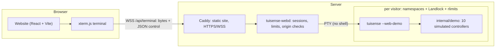

# TuiSense Web Demo

The web demo runs **the real TuiSense application** in a visitor's browser. It
is not a re-implementation: every character in the browser terminal is written
by the same `tuisense` binary that is released for Linux, built from the same
commit, running in `--web-demo` mode with simulated controllers.

The demo can run in two ways, from the same code:

| | WebAssembly (static) | Server |
|---|---|---|
| Where TuiSense runs | In the visitor's browser, compiled to WebAssembly, in a Web Worker | On the server, one sandboxed process per visitor |
| Hosting | Any static host — **GitHub Pages** (`.github/workflows/pages.yml`) | A Linux VPS or container host (`website/deployment`) |
| Session data | In memory in the browser tab | Private temporary directory on the server |
| Build | `make web-pages` | `make web-build` / Docker |

- [Static WebAssembly demo (GitHub Pages)](#static-webassembly-demo-github-pages)
- [Architecture](#architecture)
- [Web demo mode](#web-demo-mode)
- [Simulated controllers](#simulated-controllers)
- [Keyboard, mouse and clipboard](#keyboard-mouse-and-clipboard)
- [Sessions](#sessions)
- [Security](#security)
- [Run it locally](#run-it-locally)
- [Deploy](#deploy)
- [Configuration](#configuration)
- [Testing](#testing)
- [Limitations](#limitations)

## Static WebAssembly demo (GitHub Pages)

Limoni, TuiSense's terminal engine, has a WebAssembly backend that renders
into xterm.js. `make web-wasm` compiles the unchanged `cmd/tuisense` with
`GOOS=js GOARCH=wasm` (version and commit embedded as in every build) and
copies Go's `wasm_exec.js`; `make web-pages` builds the website with
`VITE_DEMO_MODE=wasm`. The page then:

1. starts a Web Worker (`website/frontend/src/wasm/worker.ts`) with an
   in-memory file system for settings, profiles and reports
   (`src/wasm/memfs.ts`);
2. runs `tuisense --web-demo` in it — the same web demo mode, simulated
   controllers and restrictions as on the server;
3. connects Limoni's bridge (`__limoni_output`, `__limoni_input`,
   `__limoni_resize`) to the page's xterm.js with messages.

**Restart Demo** starts a fresh worker with a copy of the session's files;
**Reset Session** starts one without them; quitting TuiSense ends its worker.
Nothing is sent to any server, and closing the tab deletes everything. The
browser itself isolates each visitor. The download is about 4 MB compressed
(17 MB uncompressed) and cached afterwards.

**Publishing on GitHub Pages:** in the repository's *Settings → Pages*, set
*Source* to *GitHub Actions*. Every push to `main` then runs
`.github/workflows/pages.yml`, which builds the WebAssembly module and the site
under the Pages path (for example `https://<owner>.github.io/TuiSense/`), runs
the browser end-to-end test against it, and deploys it.

Local preview:

```bash
VITE_BASE=/TuiSense/ make web-pages
mkdir -p /tmp/site && cp -r website/frontend/dist /tmp/site/TuiSense
python3 -m http.server 8091 --directory /tmp/site   # http://127.0.0.1:8091/TuiSense/
```

## Architecture



| Part | Where | What it does |
|------|-------|--------------|
| Static website | `website/frontend` | Landing page and the demo page with an xterm.js terminal. Can be hosted on any static host. |
| Backend | `website/backend` (`tuisense-webd`) | WebSocket API, one pseudo-terminal per visitor, session lifecycle, limits, sandbox. |
| Session runtime | `cmd/tuisense --web-demo` | The normal TuiSense UI on simulated devices only. |
| Deployment | `website/deployment` | Dockerfiles, hardened `docker-compose.yml`, `Caddyfile`, systemd unit, `.env.example`. |

The browser terminal is a plain terminal emulator. The backend copies bytes
between the WebSocket and the pseudo-terminal and handles a handful of JSON
control messages (`start`, `resize`, `restart`, `reset`, `close`; `ready`,
`exit`, `started`, `warning`, `notice`, `error`). There is no UI code in
JavaScript: when the TuiSense interface changes, the next build of the demo
shows the change.

Limoni draws with ANSI/VT sequences that xterm.js implements: true colour,
the alternate screen, SGR mouse reporting with motion (DEC 1003 + 1006), focus
events (1004), bracketed paste (2004), synchronized output (2026) and REP.
The backend sets `TERM=xterm-256color` and `COLORTERM=truecolor`. TuiSense draws
its 3D models with braille characters; few web fonts include them, so the site
ships a 2 KB generated braille font on JetBrains Mono's cell
(`website/frontend/scripts/make_braille_font.py`) and every dot stays on the
grid.

**Version identity.** `tuisense-webd` and `tuisense` are built in one step
with the version from `VERSION` and the Git commit (`-X …/version.Commit`).
The backend reads `tuisense --version` at start-up, warns if the commits
differ, and publishes both in `GET /api/info`. The demo bar shows the version
and links to the exact commit; TuiSense shows its version in the header as
always.

## Web demo mode

`tuisense --web-demo` starts the normal interface. The differences are in the
device backend and in what the application is allowed to do, enforced in code
(`internal/app/webdemo.go`, `internal/demo`), not by hiding menu items:

| Normal mode | Web demo mode |
|-------------|---------------|
| Hardware drivers discover and open controllers (hidraw, evdev, XInput) | The registry contains **no hardware driver**: nothing is enumerated or opened |
| Commands go to the controller | Commands are recorded in memory; vibration is reported as simulated |
| ALSA probes controller audio | In-memory simulated audio only |
| Firmware metadata is fetched from Sony | No firmware provider (no network request) |
| Driver & Compatibility reads the system and can run approved fixes through polkit | A fixed simulated system; every action is refused |
| Links open the browser | Refused (there is no browser on the server) |
| Clipboard through wl-copy/xclip/xsel or OSC 52 | OSC 52 only, which the browser terminal forwards |
| Application updates | Disabled: no check, no download, no install |
| Ctrl+Z suspends | Disabled (there is no shell to resume from) |

The header shows a quiet indicator, **WEB DEMO — SIMULATED CONTROLLERS**, next
to the version, and the controller pill reads **SIMULATED**. Diagnostics and
health reports carry the existing "simulated device — not a hardware
measurement" notices.

## Simulated controllers

All ten controller models are available from the controller selector (`C`):

| Model | Simulation | What the model shows |
|-------|------------|----------------------|
| Sony DualSense | DualSense mock backend | Adaptive triggers, light bar, player LEDs, haptics, touchpad, motion, audio, battery |
| Sony DualSense Edge | DualSense mock backend, Edge descriptor | As above plus back buttons and Fn buttons |
| Xbox Wireless Controller | `internal/demo` pad (xpad layout) | Rumble, battery; trigger rumble and audio present but not reachable |
| Xbox Elite Wireless Controller Series 2 | pad (xpad layout + paddles) | Four rear paddles reported, rumble, battery |
| Sony DualShock 4 | pad (hid-playstation layout) | Rumble, battery, USB audio; touchpad, motion and light bar present but not reachable |
| Nintendo Switch Pro Controller | pad (hid-nintendo layout) | Digital ZL/ZR, rumble, battery |
| 8BitDo Ultimate Bluetooth | pad (xpad layout) | Rumble, battery; rear buttons mapped by the controller itself |
| GameSir G7 SE | pad (xpad layout) | Wired, rumble |
| Razer Wolverine V3 Pro | pad (xpad layout) | Rumble, battery; back buttons not reported separately |
| MSI Force GC20 V2 | pad (xpad 360 layout) | Wired, two rumble motors — no battery, lighting, touchpad, microphone or adaptive triggers |

The eight models that Linux serves through kernel drivers are described by
their **real descriptor builders** (`internal/drivers/padmodels`,
`internal/drivers/msigc20`) from a synthetic input layout that matches what
their kernel driver reports (axis ranges, key codes, rumble, battery). The
capabilities, regions, labels and 3D visuals are therefore exactly what a
connected controller of that model gets — including the honest "present but
not reachable" states, which the demo does not paper over.

Input comes from the scenario generator in `internal/drivers/simulate`: a
continuous demo motion by default, and the dedicated scenarios the existing
diagnostics engine asks for (sticks released and rotated, buttons pressed one
by one, trigger sweeps, touch, motion, stick snapback). Some models rest
slightly off-centre so the drift test has something to find. Battery levels
are simulated, slowly drain, and are labelled as such; no battery health is
ever invented. Diagnostics, health reports, profiles and settings use the
normal engine and are stored in the session's temporary directory.

## Keyboard, mouse and clipboard

- **Keyboard:** every key TuiSense uses natively reaches it (letters, digits,
  arrows, Tab, Shift+Tab, Enter, Esc, Space, PgUp/PgDn, Ctrl+C). The browser
  keeps reload (F5, Ctrl/⌘+R), developer tools, its fullscreen key (F11),
  paste (Ctrl/⌘+V, Ctrl+Shift+V) and ⌘ shortcuts on macOS.
- **Mouse:** clicks, motion (hover), drag (orbit the 3D model) and the wheel
  (zoom) are sent as SGR mouse reports. Shift+drag (Option+drag on macOS)
  selects text instead.
- **Clipboard:** TuiSense's copy actions (`y`/`Y`, copy buttons) arrive as
  OSC 52 and are written to the visitor's clipboard. Reads are refused, so the
  server can never see the visitor's clipboard. Ctrl/⌘+C copies a selection.
- **Fullscreen:** the Fullscreen button keeps Esc for TuiSense where the
  browser supports keyboard lock; hold Esc or use *Exit fullscreen* to leave.
- **Size:** the terminal follows the window. It never stretches character
  cells and never goes below TuiSense's minimum of 40×12; on smaller screens
  the frame scrolls and a notice explains why.

## Sessions

- Every visitor gets an independent session: its own `tuisense` process, its
  own pseudo-terminal and its own private directory (`0700`).
- A session survives a page reload or a dropped connection for
  `RECONNECT_GRACE` (the tab keeps a secret token in `sessionStorage`); the
  terminal modes are replayed and the screen redrawn.
- **Restart Demo** replaces the process and keeps the session's settings;
  **Reset Session** also deletes them. Quitting TuiSense shows a dialog to
  start it again — there is no shell behind it.
- A session ends after `IDLE_TIMEOUT` without input (with a warning a minute
  before), after `MAX_DURATION` in any case, when the browser does not come
  back within the grace period, when the visitor leaves with *Back to
  Website*, or when the server shuts down. Ending kills the whole process
  group, releases the pseudo-terminal and deletes the directory.
- No account, no cookies, no analytics. Client addresses are used in memory
  for limits only and are not logged.

## Security

The demo is public, so every layer assumes hostile input.

**Request level** (`website/backend/server/server.go`)

- Terminal WebSockets are accepted only from the configured origins
  (`ALLOWED_ORIGINS`, or same-origin); requests without an `Origin` are refused.
- Per-address limits: concurrent sessions, new sessions per minute, API
  requests per minute; a global session cap; per-session input byte budget;
  64 KiB maximum message size; resize values are clamped.
- Strict security headers (CSP, `frame-ancestors 'none'`, no referrer,
  Permissions-Policy denying USB, HID, serial, Bluetooth, gamepad, camera and
  microphone).

**Process level** (`website/backend/server/sandbox.go`, `process.go`)

- `tuisense` is started directly with a fixed argument vector from the
  operator's configuration — never through a shell, never with anything from
  the request. The visitor's language is reduced to `en` or `tr`.
- The environment is rebuilt from scratch (no server variables or secrets).
- A sandbox helper (the backend binary itself) runs between fork and exec:
  `no_new_privs`, every capability dropped, rlimits (address space, CPU time,
  open files, file size, no core dumps), niceness, then:
  - **Landlock**: read-write access only to the session's own directory
    (never executable), read+execute on the `tuisense` binary, read-only time
    zone data; with Landlock ABI ≥ 4 no TCP bind/connect; with ABI ≥ 6 no
    signals or abstract UNIX sockets outside the session.
  - **Namespaces** where allowed: own user (mapped to the unprivileged service
    user), PID (cannot see or signal anything else; it dies with its init),
    network (no interfaces at all), IPC and UTS namespaces.
- The backend refuses to run as root and kills every session process if it
  dies (`PR_SET_PDEATHSIG`).

**Host level** (`website/deployment`)

- Docker: distroless static image without shell or package manager, user
  65532, read-only root filesystem, `cap_drop: ALL`, `no-new-privileges`,
  `/tmp` as `noexec` tmpfs, memory/CPU/PID ceilings, no devices, no Docker
  socket, and an `internal` network with no route to the internet.
- Docker's default seccomp profile forbids namespaces, so use
  `TUISENSE_WEB_SANDBOX=landlock` there (requires Linux ≥ 5.13 and a Docker
  version whose default profile allows the Landlock system calls; the backend
  refuses to start otherwise). For namespaces as well, install with the systemd
  unit (`TUISENSE_WEB_SANDBOX=strict`) or run the container under gVisor
  (`runtime: runsc`).
- systemd: `DynamicUser`, `PrivateDevices`, `ProtectSystem=strict`, empty
  capability set, restricted namespaces and address families, memory/task/CPU
  ceilings.

The backend logs the confinement it applied at start-up
(`"plan":"mode=strict namespaces=true landlock_abi=7"`) and warns when it is
partial.

## Run it locally

Requirements: Linux, Go 1.25, Node.js 22.

```bash
make web-run      # builds tuisense, tuisense-webd and the website, then serves
                  # them on http://127.0.0.1:8080 (as your own user, never root)
```

For frontend development, keep the backend running and start Vite, which
proxies `/api` (including the WebSocket) to it:

```bash
cd website/frontend && npm install && npm run dev   # http://localhost:5173
```

## Deploy

The interactive terminal needs a server: a static host such as GitHub Pages can
serve the website, but not the backend or the sessions. Any Linux VPS or
container host that allows WebSockets works.

**Docker Compose** (two containers: Caddy with the website, and the backend):

```bash
cd website/deployment
cp .env.example .env        # set DEMO_DOMAIN; point its DNS at the server
GIT_COMMIT=$(git rev-parse HEAD) docker compose up -d --build
docker compose logs backend # check the "sandbox" line
```

Caddy obtains the HTTPS certificate for `DEMO_DOMAIN`, so the terminal runs
over WSS. The backend is reachable only through Caddy (`internal` network) and
accepts terminal connections only from `https://$DEMO_DOMAIN`. Health checks:
`GET /healthz` (liveness) and `GET /readyz`.

**systemd** (VPS without containers, strict sandbox): install the two binaries
and `website/deployment/tuisense-webd.service`, put the settings in
`/etc/tuisense-web.env`, and put Caddy or nginx in front of
`127.0.0.1:8080` with TLS and WebSocket upgrades for `/api/terminal`.

**Website on another host:** build the frontend with
`VITE_API_BASE=https://api.example.com` and set
`TUISENSE_WEB_ALLOWED_ORIGINS=https://www.example.com` on the backend.

Deploy the backend from the same commit as the release you want to show; the
demo bar and `/api/info` show which one is running.

## Configuration

All backend settings are `TUISENSE_WEB_*` environment variables, documented
with their defaults in
[`website/deployment/.env.example`](../website/deployment/.env.example):
listen address, binary path, allowed origins, proxy trust, session/IP limits,
start and input rates, idle/maximum/reconnect timeouts, per-session memory,
CPU, file and parallelism limits, frame rate and sandbox mode. The website
takes `VITE_API_BASE`, `VITE_GITHUB_URL` and `VITE_DOWNLOAD_URL` at build time.

## Testing

| Suite | Command | Covers |
|-------|---------|--------|
| Web demo mode | `go test ./internal/app ./internal/demo` | ten simulated models, real descriptors and visuals, capability visibility (e.g. no battery on the GC20 V2), EZ/Advanced and model switching through the UI, diagnostics on simulated input, simulated reports, refused host actions (updates, drivers, browser, firmware, clipboard tools) |
| Backend | `go test ./website/backend/...` | builds the real `tuisense` and drives it over the WebSocket with a VT screen emulator: keyboard, SGR mouse, resize, OSC 52, exit without shell, restart/reset, reconnect, concurrent isolated sessions, process confinement (`/proc`), Landlock (files, TCP, signals), origins, capacity/per-IP/start/HTTP/input limits, idle/expiry/abandon cleanup, shutdown |
| Website | `cd website/frontend && npm test` | key routing, size bounds, protocol parsing, reconnect tokens |
| End to end (WebAssembly) | `TUISENSE_E2E_MODE=wasm TUISENSE_E2E_URL=… node website/e2e/demo.e2e.cjs` | the same browser checks against the static GitHub Pages build (run by `pages.yml` before every deployment) |
| End to end | `make web-e2e` | Chromium + the built site + `tuisense-webd` + `tuisense`: landing page, launch, version, native keyboard and mouse, model switching, capability-aware tabs, EZ/Advanced, resize and small screens, clipboard, restart/reset/exit, fullscreen, session end |

## Limitations

- The demo needs a Linux server; the session sandbox uses Linux pseudo-
  terminals, Landlock and namespaces.
- Inside Docker's default seccomp profile, sessions are confined by Landlock,
  rlimits and the container, but not by namespaces (see [Security](#security)).
  Landlock restricts TCP but not UDP; there, the container's `internal`
  network (no route out) is what keeps sessions off the network. Keep it, or
  use the strict sandbox, which gives every session an empty network
  namespace.
- Per-session memory is limited as address space (RLIMIT_AS, ≥ 768 MiB because
  of the Go runtime) plus a garbage-collector target; physical memory is capped
  for the whole service by the container or systemd.
- Firmware checks against Sony's servers are not available in the demo (no
  network), and Driver & Compatibility shows the simulated system only.
- A few rarely used symbols (for example ⧉ or ᛒ) come from the visitor's system
  fonts and may look slightly different from a native terminal.
- Touch devices can view and tap, but TuiSense is a keyboard-and-mouse
  application; a desktop browser gives the full experience.
